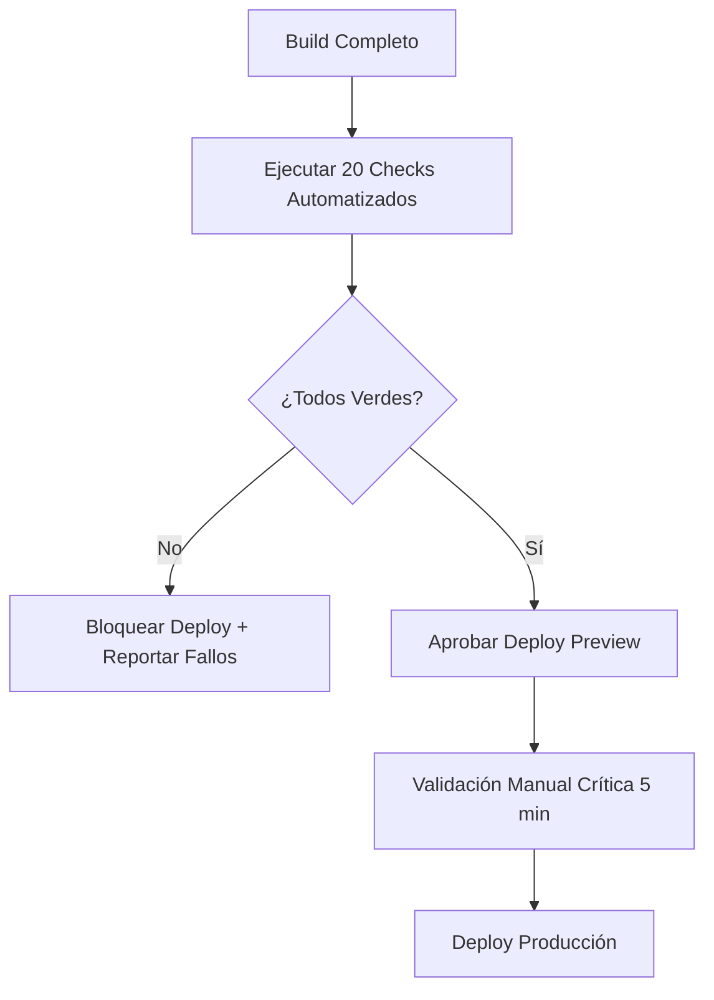

# SKILL: CHECKLIST DE LANZAMIENTO WEB (20 PUNTOS — SEO, SCHEMA.ORG, CORE WEB VITALS)
**Versión:** 1.0 | **Activación:** `@skill launch-checklist`

---

## PROTOCOLO: **CERO DEPLOY SIN 20/20 VERDE**



---

## LOS 20 PUNTOS CRÍTICOS

### 🔴 GRUPO 1: SEO TÉCNICO FUNDAMENTAL (5 pts)

| # | Check | Validación Automatizada | Herramienta |
|---|-------|------------------------|-------------|
| **1** | **Sitemap.xml válido + accesible** | `GET /sitemap.xml` → 200 + XML válido + `<urlset>` | `sitemap-validator` / custom script |
| **2** | **Robots.txt correcto** | `GET /robots.txt` → 200 + `User-agent: *` + `Allow: /` + `Sitemap:` | `robots-txt-validator` |
| **3** | **Meta tags únicos por página** | Crawl todas las URLs → `title`, `description`, `canonical` únicos + longitud óptima | `lighthouse` / `seo-meta-checker` |
| **4** | **Open Graph + Twitter Cards completos** | `og:title`, `og:description`, `og:image` (1200x630), `og:url`, `og:type`, `twitter:card` | `opengraph-checker` |
| **5** | **Estructura heading jerárquica (H1→H6)** | 1 solo H1 por página + secuencia lógica sin saltos | `axe-core` / `heading-checker` |

### 🟠 GRUPO 2: SCHEMA.ORG + DATOS ESTRUCTURADOS (4 pts)

| # | Check | Validación | Tipos Requeridos por Página |
|---|-------|------------|----------------------------|
| **6** | **JSON-LD válido en todas las páginas** | `Structured Data Testing Tool` / `schema-dts` → 0 errores | `WebSite`, `Organization` (global) |
| **7** | **Schema específico por tipo página** | Validar tipo según ruta | **Home:** `WebSite` + `Organization`<br/>**Producto:** `Product` + `Offer` + `AggregateRating`<br/>**Artículo:** `Article` + `NewsArticle`/`BlogPosting`<br/>**Local:** `LocalBusiness` + `OpeningHoursSpecification`<br/>**FAQ:** `FAQPage` + `Question`/`Answer` |
| **8** | **Breadcrumbs + Navigation markup** | `BreadcrumbList` + `SiteNavigationElement` en layout | Requerido en páginas > nivel 2 |
| **9** | **Rich Results elegibles (Google Search Console)** | Search Console → Enhancements → 0 errores críticos | Testear: `Product`, `FAQ`, `Article`, `LocalBusiness` |

### 🟡 GRUPO 3: CORE WEB VITALS + PERFORMANCE (5 pts)

| # | Métrica | Target (Good) | Validación |
|---|---------|---------------|------------|
| **10** | **LCP (Largest Contentful Paint)** | **< 2.5s** | Lighthouse CI / Web Vitals API / PageSpeed Insights |
| **11** | **INP (Interaction to Next Paint)** | **< 200ms** | Lighthouse CI / web-vitals library (reemplaza FID) |
| **12** | **CLS (Cumulative Layout Shift)** | **< 0.1** | Lighthouse CI / Layout Shift API |
| **13** | **TTFB (Time to First Byte)** | **< 800ms** | `curl -w "TTFB: %{time_starttransfer}s" -o /dev/null -s URL` |
| **14** | **Budget: JS Total < 170KB gzip / CSS < 50KB gzip** | `webpack-bundle-analyzer` / `next-bundle-analyzer` | Fail build si excede |

### 🟢 GRUPO 4: SEGURIDAD + HEADERS + ACCESIBILIDAD (4 pts)

| # | Check | Validación | Configuración Requerida |
|---|-------|------------|------------------------|
| **15** | **Security Headers (A+ en SecurityHeaders.com)** | `securityheaders.com` / `observatory.mozilla.org` | `Content-Security-Policy`, `X-Frame-Options: DENY`, `X-Content-Type-Options: nosniff`, `Referrer-Policy: strict-origin-when-cross-origin`, `Permissions-Policy`, `Strict-Transport-Security: max-age=31536000; includeSubDomains; preload` |
| **16** | **HTTPS forzado + HSTS preload ready** | `curl -I https://dominio.com` → `Strict-Transport-Security` | Certificado válido (Let's Encrypt / Cloudflare) + HSTS 1 año |
| **17** | **Accesibilidad WCAG 2.1 AA (Lighthouse ≥ 95)** | `lighthouse --only-categories=accessibility` | Contraste, ARIA labels, focus visible, landmarks, alt text |
| **18** | **No mixed content + CSP report-only mode** | DevTools Console → 0 mixed content warnings | `Content-Security-Policy-Report-Only` en staging |

### 🔵 GRUPO 5: OPERACIONES + MONITORIZACIÓN (2 pts)

| # | Check | Validación |
|---|-------|------------|
| **19** | **Health Check Endpoint (`/health` / `/ready`)** | `GET /api/health` → 200 + `{ "status": "ok", "checks": { "db": "ok", "redis": "ok", "external_apis": "ok" } }` |
| **20** | **Error Tracking + Alerting configurado** | Sentry / Datadog / LogRocket → DSN configurado + alertas en Slack/Email para error rate > 1% |

---

## IMPLEMENTACIÓN AUTOMATIZADA (CI/CD GATE)

### Script de Validación Unificado
```bash
#!/bin/bash
# scripts/launch-checklist.sh
# Exit code 0 = PASS, 1 = FAIL

set -euo pipefail

URL="${1:-https://preview.tudominio.com}"
FAILURES=0

echo "🚀 LAUNCH CHECKLIST — $URL"
echo "================================"

# 1. Sitemap
check_sitemap() {
  curl -sf "$URL/sitemap.xml" | xmllint --noout - 2>/dev/null && echo "✅ 1/20 Sitemap válido" || { echo "❌ 1/20 Sitemap INVÁLIDO"; return 1; }
}

# 2. Robots.txt
check_robots() {
  curl -sf "$URL/robots.txt" | grep -q "Sitemap:" && echo "✅ 2/20 Robots.txt OK" || { echo "❌ 2/20 Robots.txt FALTA SITEMAP"; return 1; }
}

# 3. Meta tags (sample: home, 3 páginas internas)
check_meta() {
  for path in "" "/producto/demo" "/blog/articulo" "/nosotros"; do
    html=$(curl -sf "$URL$path")
    echo "$html" | grep -q '<title>.*</title>' || { echo "❌ 3/20 Meta tags faltantes en $path"; return 1; }
    echo "$html" | grep -q '<meta name="description"' || { echo "❌ 3/20 Description faltante en $path"; return 1; }
    echo "$html" | grep -q '<link rel="canonical"' || { echo "❌ 3/20 Canonical faltante en $path"; return 1; }
  done
  echo "✅ 3/20 Meta tags únicos presentes"
}

# 4. Open Graph + Twitter
check_og() {
  html=$(curl -sf "$URL")
  for tag in 'og:title' 'og:description' 'og:image' 'og:url' 'og:type' 'twitter:card'; do
    echo "$html" | grep -q "property=\"$tag\"" || echo "$html" | grep -q "name=\"$tag\"" || { echo "❌ 4/20 Falta $tag"; return 1; }
  done
  echo "✅ 4/20 Open Graph + Twitter completos"
}

# 5. Headings (requiere HTML parser - usar node script)
check_headings() {
  npx -y @orama/check-headings "$URL" || { echo "❌ 5/20 Estructura headings inválida"; return 1; }
  echo "✅ 5/20 Headings jerárquicos correctos"
}

# 6-9. Schema.org (usar Google SDTT API o validator local)
check_schema() {
  npx -y @orama/check-schema "$URL" || { echo "❌ 6-9/20 Schema.org inválido"; return 1; }
  echo "✅ 6-9/20 Schema.org válido + tipos correctos"
}

# 10-14. Core Web Vitals (Lighthouse CI)
check_cwv() {
  npx -y @lhci/cli autorun --url="$URL" --upload.target=temporary-public-storage || { echo "❌ 10-14/20 CWV fuera de target"; return 1; }
  echo "✅ 10-14/20 Core Web Vitals en verde"
}

# 15. Security Headers
check_security_headers() {
  headers=$(curl -sI "$URL")
  for h in "Content-Security-Policy" "X-Frame-Options" "X-Content-Type-Options" "Referrer-Policy" "Strict-Transport-Security"; do
    echo "$headers" | grep -qi "$h" || { echo "❌ 15/20 Falta header: $h"; return 1; }
  done
  echo "✅ 15/20 Security Headers completos"
}

# 16. HTTPS + HSTS
check_https() {
  curl -sI "$URL" | grep -qi "Strict-Transport-Security" || { echo "❌ 16/20 HSTS faltante"; return 1; }
  echo "✅ 16/20 HTTPS + HSTS configurado"
}

# 17. Accesibilidad
check_a11y() {
  npx -y @lhci/cli autorun --url="$URL" --only-categories=accessibility --assert.min-score=0.95 || { echo "❌ 17/20 Accesibilidad < 95"; return 1; }
  echo "✅ 17/20 Accesibilidad WCAG 2.1 AA"
}

# 18. Mixed Content
check_mixed_content() {
  # Verificar en build que no hay http:// en assets
  grep -r "http://" .next/ dist/ build/ 2>/dev/null | grep -v node_modules && { echo "❌ 18/20 Mixed content detectado"; return 1; }
  echo "✅ 18/20 Sin mixed content"
}

# 19. Health Check
check_health() {
  curl -sf "$URL/api/health" | jq -e '.status == "ok" and .checks.db == "ok"' >/dev/null || { echo "❌ 19/20 Health check fallando"; return 1; }
  echo "✅ 19/20 Health endpoint OK"
}

# 20. Error Tracking
check_error_tracking() {
  # Verificar variable de entorno SENTRY_DSN en build
  grep -q "SENTRY_DSN" .env.production || { echo "❌ 20/20 Error tracking no configurado"; return 1; }
  echo "✅ 20/20 Error tracking configurado"
}

# EJECUTAR TODOS
for check in check_sitemap check_robots check_meta check_og check_headings check_schema check_cwv check_security_headers check_https check_a11y check_mixed_content check_health check_error_tracking; do
  $check || FAILURES=$((FAILURES + 1))
done

echo "================================"
if [ $FAILURES -eq 0 ]; then
  echo "🎉 20/20 CHECKS PASSED — DEPLOY APPROVED"
  exit 0
else
  echo "💥 $FAILURES/20 CHECKS FALLARON — DEPLOY BLOCKED"
  exit 1
fi
```

### Integración GitHub Actions
```yaml
# .github/workflows/launch-checklist.yml
name: Launch Checklist (Pre-Deploy)
on:
  pull_request:
    types: [opened, synchronize, reopened]
  workflow_dispatch:

jobs:
  launch-checklist:
    runs-on: ubuntu-latest
    steps:
      - uses: actions/checkout@v4
      - uses: actions/setup-node@v4
        with: { node-version: '20', cache: 'npm' }
      - run: npm ci
      - run: npm run build
      - name: Start Preview Server
        run: npm run preview & sleep 10
      - name: Run Launch Checklist
        env:
          PREVIEW_URL: http://localhost:3000
        run: |
          chmod +x scripts/launch-checklist.sh
          ./scripts/launch-checklist.sh "$PREVIEW_URL"
      - name: Upload Lighthouse Report
        if: always()
        uses: actions/upload-artifact@v4
        with:
          name: lighthouse-report
          path: .lighthouseci/
```

---

## VALIDACIÓN MANUAL CRÍTICA (5 MIN — POST-AUTOMÁTICO)

| Acción | Qué Verificar |
|--------|---------------|
| **Navegación real** | Click en todos los CTA principales → destino correcto + tracking |
| **Formulario crítico** | Submit válido → éxito + email confirmation + error handling |
| **Mobile real** | Chrome DevTools device toolbar (iPhone 15 Pro) → touch targets ≥ 48px, no overflow |
| **Modo incógnito** | Sin cache → primera carga LCP visual < 2.5s |
| **Search Console** | `site:tudominio.com` → páginas indexadas = páginas sitemap |

---

## CHECKLIST DE ENTREGA LAUNCH (Definition of Done)

- [ ] Script `launch-checklist.sh` ejecutándose en CI/CD (bloquea merge si falla)
- [ ] Lighthouse CI configurado con budgets CWV (LCP<2.5, INP<200, CLS<0.1)
- [ ] Schema.org JSON-LD en todas las plantillas + validado en Search Console
- [ ] Security Headers A+ en securityheaders.com
- [ ] Accesibilidad Lighthouse ≥ 95 en todas las plantillas
- [ ] Health endpoint + Error tracking (Sentry) funcional en preview
- [ ] Sitemap + Robots.txt + Meta tags + OG/Twitter auto-generados por build
- [ ] Bundle size budgets configurados y enforcados en CI
- [ ] Documentación de rollback + runbook incidentes en `docs/06/Runbook.md`