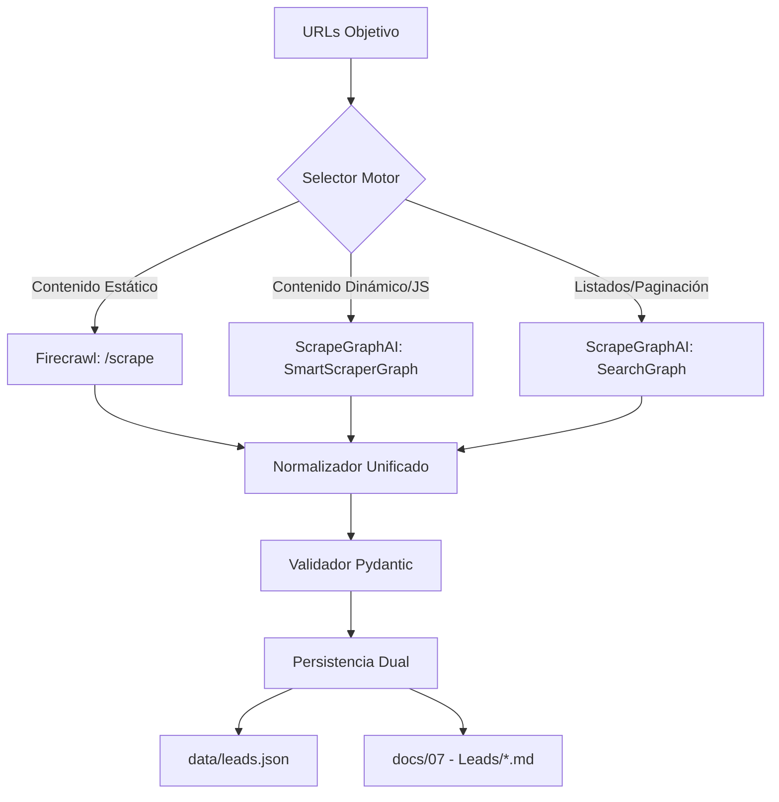

# SKILL: LEAD SCRAPER SCRAPEGRAPHAI
**Versión:** 1.0 | **Activación:** `@skill lead-scraper`

---

## 1. EXTRACCIÓN AUTOMATIZADA CON SCRAPEGRAPHAI + FIRECRAWL

### Arquitectura de Extracción


### Configuración de Motores

#### Firecrawl (Recomendado para: landing pages, docs, blogs estáticos)
```python
# lead_scraper/engines/firecrawl_engine.py
from firecrawl import FirecrawlApp
from pydantic import BaseModel
from typing import List, Optional

class LeadSchema(BaseModel):
    nombre: str
    email: Optional[str]
    telefono: Optional[str]
    empresa: Optional[str]
    cargo: Optional[str]
    linkedin: Optional[str]
    fuente_url: str
    fecha_extraccion: str

class FirecrawlEngine:
    def __init__(self, api_key: str):
        self.app = FirecrawlApp(api_key=api_key)

    def scrape_single(self, url: str, schema: dict) -> List[LeadSchema]:
        result = self.app.scrape_url(url, {
            'formats': ['extract'],
            'extract': {'schema': schema}
        })
        return [LeadSchema(**item, fuente_url=url) for item in result.get('extract', [])]

    def crawl_site(self, url: str, schema: dict, max_pages: int = 50) -> List[LeadSchema]:
        result = self.app.crawl_url(url, {
            'limit': max_pages,
            'scrapeOptions': {'formats': ['extract'], 'extract': {'schema': schema}}
        })
        leads = []
        for page in result.get('data', []):
            for item in page.get('extract', []):
                leads.append(LeadSchema(**item, fuente_url=page['metadata']['sourceURL']))
        return leads
```

#### ScrapeGraphAI (Recomendado para: directorios, SPAs, contenido renderizado por JS)
```python
# lead_scraper/engines/scrapegraph_engine.py
from scrapegraphai.graphs import SmartScraperGraph, SearchGraph
from pydantic import BaseModel
from typing import List, Optional
import os

class LeadSchema(BaseModel):
    nombre: str
    email: Optional[str]
    telefono: Optional[str]
    empresa: Optional[str]
    cargo: Optional[str]
    linkedin: Optional[str]
    fuente_url: str
    fecha_extraccion: str

class ScrapeGraphEngine:
    def __init__(self):
        self.graph_config = {
            "llm": {
                "model": "ollama/llama3.1",  # Local, sin coste
                "temperature": 0,
                "base_url": "http://localhost:11434",
            },
            "embeddings": {
                "model": "ollama/nomic-embed-text",
                "base_url": "http://localhost:11434",
            },
            "verbose": True,
            "headless": True,
        }

    def smart_scrape(self, url: str, prompt: str) -> List[LeadSchema]:
        graph = SmartScraperGraph(
            prompt=prompt,
            source=url,
            config=self.graph_config,
            schema=LeadSchema
        )
        result = graph.run()
        return [LeadSchema(**item, fuente_url=url) for item in result.get('leads', [])]

    def search_leads(self, query: str, prompt: str) -> List[LeadSchema]:
        graph = SearchGraph(
            prompt=prompt,
            source=query,
            config=self.graph_config,
            schema=LeadSchema
        )
        result = graph.run()
        leads = []
        for item in result.get('leads', []):
            leads.append(LeadSchema(**item, fuente_url=item.get('source_url', '')))
        return leads
```

---

## 2. PROMPTS DE EXTRACCIÓN ESTANDARIZADOS

### Prompt SmartScraper (Página individual)
```python
SMART_SCRAPER_PROMPT = """
Extrae TODOS los contactos/leads visibles en esta página.
Para cada lead, captura EXACTAMENTE estos campos:
- nombre: Nombre completo de la persona
- email: Email de contacto (si visible)
- telefono: Teléfono (si visible)
- empresa: Nombre de la empresa/organización
- cargo: Título/puesto de la persona
- linkedin: URL de perfil LinkedIn (si visible)

REGLAS ESTRICTAS:
- Si un campo no está visible, usa null (NO inventes)
- Solo extrae personas reales, NO empresas genéricas
- Ignora footer, navegación, avisos legales
- Devuelve array JSON válido bajo clave "leads"
"""
```

### Prompt SearchGraph (Búsqueda amplia)
```python
SEARCH_GRAPH_PROMPT = """
Busca y extrae leads de: {query}
Fuentes objetivo: directorios profesionales, páginas de equipo, LinkedIn público, directorios sectoriales.
Para cada lead encontrado, extrae: nombre, email, telefono, empresa, cargo, linkedin, fuente_url.
Máximo 50 resultados. Prioriza contactos con email visible.
"""
```

---

## 3. FORMATO DE SALIDA DUAL (OBLIGATORIO)

### A. Persistencia Local: `data/leads.json`
```json
{
  "metadata": {
    "total_leads": 147,
    "fuentes_procesadas": 12,
    "fecha_extraccion": "2026-10-08T14:30:00Z",
    "motor_usado": "mixed",
    "version_schema": "1.0"
  },
  "leads": [
    {
      "nombre": "María González",
      "email": "maria.gonzalez@clinicasanrafael.com",
      "telefono": "+34 91 123 4567",
      "empresa": "Clínica San Rafael",
      "cargo": "Directora Médica",
      "linkedin": "https://linkedin.com/in/mariagonzalezmed",
      "fuente_url": "https://clinicasanrafael.com/equipo",
      "fecha_extraccion": "2026-10-08T14:25:12Z"
    }
  ]
}
```

### B. Notas Obsidian: `docs/07 - Leads/`
```markdown
# Lead: María González - Directora Médica @ Clínica San Rafael

**Fuente:** [[https://clinicasanrafael.com/equipo|Página Equipo Clínica San Rafael]]
**Extraído:** 2026-10-08 14:25:12
**Motor:** Firecrawl

## Contacto
- **Email:** maria.gonzalez@clinicasanrafael.com
- **Teléfono:** +34 91 123 4567
- **LinkedIn:** [linkedin.com/in/mariagonzalezmed](https://linkedin.com/in/mariagonzalezmed)

## Contexto
- **Empresa:** Clínica San Rafael
- **Cargo:** Directora Médica
- **Sector:** Salud / Clínicas privadas
- **Ubicación:** Madrid, España

## Tags
#lead #salud #directivo #madrid #email-verificado

## Acciones
- [ ] Verificar email (Hunter.io / NeverBounce)
- [ ] Añadir a CRM (HubSpot / Pipedrive)
- [ ] Enviar secuencia cold email (Plantilla: Clínicas - Recordatorios WhatsApp)
- [ ] Registrar interacción en `data/leads_interactions.json`
```

### Generador de Notas Obsidian
```python
# lead_scraper/exporters/obsidian_exporter.py
from pathlib import Path
from datetime import datetime
from typing import List
from ..models import LeadSchema

class ObsidianExporter:
    def __init__(self, vault_path: str = "docs/07 - Leads"):
        self.vault_path = Path(vault_path)
        self.vault_path.mkdir(parents=True, exist_ok=True)

    def export_leads(self, leads: List[LeadSchema]) -> int:
        count = 0
        for lead in leads:
            filename = self._sanitize_filename(f"{lead.nombre} - {lead.cargo} @ {lead.empresa}.md")
            filepath = self.vault_path / filename
            content = self._generate_note(lead)
            filepath.write_text(content, encoding='utf-8')
            count += 1
        return count

    def _generate_note(self, lead: LeadSchema) -> str:
        return f"""# Lead: {lead.nombre} - {lead.cargo} @ {lead.empresa}

**Fuente:** [[{lead.fuente_url}|{lead.fuente_url}]]
**Extraído:** {lead.fecha_extraccion}
**Motor:** {lead.motor or 'unknown'}

## Contacto
- **Email:** {lead.email or 'No disponible'}
- **Teléfono:** {lead.telefono or 'No disponible'}
- **LinkedIn:** {f'[{lead.linkedin}]({lead.linkedin})' if lead.linkedin else 'No disponible'}

## Contexto
- **Empresa:** {lead.empresa or 'No disponible'}
- **Cargo:** {lead.cargo or 'No disponible'}
- **Sector:** {lead.sector or 'Por clasificar'}

## Tags
#lead #{lead.sector.lower().replace(' ', '-') if lead.sector else 'sin-sector'} #{lead.cargo.lower().replace(' ', '-') if lead.cargo else 'sin-cargo'}

## Acciones
- [ ] Verificar email
- [ ] Añadir a CRM
- [ ] Enviar secuencia cold email
- [ ] Registrar interacción
"""

    def _sanitize_filename(self, name: str) -> str:
        return "".join(c for c in name if c.isalnum() or c in " -_").strip() + ".md"
```

---

## 4. ORQUESTADOR PRINCIPAL

```python
# lead_scraper/orchestrator.py
from typing import List, Dict, Any
from pathlib import Path
import json
from datetime import datetime
from .engines.firecrawl_engine import FirecrawlEngine
from .engines.scrapegraph_engine import ScrapeGraphEngine
from .exporters.obsidian_exporter import ObsidianExporter
from .models import LeadSchema

class LeadScraperOrchestrator:
    def __init__(self, firecrawl_key: str = None):
        self.firecrawl = FirecrawlEngine(firecrawl_key) if firecrawl_key else None
        self.scrapegraph = ScrapeGraphEngine()
        self.obsidian = ObsidianExporter()
        self.data_path = Path("data/leads.json")
        self.data_path.parent.mkdir(exist_ok=True)

    def run_extraction(self, config: Dict[str, Any]) -> Dict[str, Any]:
        """
        config = {
            "urls": ["https://...", "https://..."],
            "search_queries": ["directorio clinicas madrid", "..."],
            "engine_preference": "auto" | "firecrawl" | "scrapegraph"
        }
        """
        all_leads = []
        fuentes_procesadas = 0

        # 1. URLs directas
        for url in config.get("urls", []):
            engine = self._select_engine(url, config.get("engine_preference"))
            leads = self._extract_with_engine(engine, url)
            all_leads.extend(leads)
            fuentes_procesadas += 1

        # 2. Búsquedas
        for query in config.get("search_queries", []):
            leads = self.scrapegraph.search_leads(query, SEARCH_GRAPH_PROMPT)
            all_leads.extend(leads)
            fuentes_procesadas += 1

        # 3. Deduplicar por email
        unique_leads = self._deduplicate_leads(all_leads)

        # 4. Persistencia dual
        self._save_json(unique_leads, fuentes_procesadas)
        self.obsidian.export_leads(unique_leads)

        return {
            "total_leads": len(unique_leads),
            "fuentes_procesadas": fuentes_procesadas,
            "duplicados_eliminados": len(all_leads) - len(unique_leads)
        }

    def _select_engine(self, url: str, preference: str):
        if preference == "firecrawl" and self.firecrawl:
            return self.firecrawl
        if preference == "scrapegraph":
            return self.scrapegraph
        # Auto: Firecrawl para URLs directas, ScrapeGraph para búsquedas
        return self.firecrawl if self.firecrawl else self.scrapegraph

    def _deduplicate_leads(self, leads: List[LeadSchema]) -> List[LeadSchema]:
        seen = set()
        unique = []
        for lead in leads:
            key = lead.email or f"no-email-{lead.nombre}-{lead.empresa}"
            if key not in seen:
                seen.add(key)
                unique.append(lead)
        return unique

    def _save_json(self, leads: List[LeadSchema], fuentes: int):
        data = {
            "metadata": {
                "total_leads": len(leads),
                "fuentes_procesadas": fuentes,
                "fecha_extraccion": datetime.utcnow().isoformat() + "Z",
                "motor_usado": "mixed",
                "version_schema": "1.0"
            },
            "leads": [lead.model_dump() for lead in leads]
        }
        self.data_path.write_text(json.dumps(data, ensure_ascii=False, indent=2))
```

---

## 5. EJECUCIÓN CLI (Ejemplo)
```bash
# Instalación
pip install firecrawl-py scrapegraphai pydantic pyyaml

# Ollama local (gratis)
ollama pull llama3.1
ollama pull nomic-embed-text

# Ejecutar
python -m lead_scraper.main \
  --urls "https://clinicasanrafael.com/equipo" "https://otracclinica.com/team" \
  --queries "directorio clinicas dentales madrid" "directorio fisioterapeutas barcelona" \
  --engine auto
```

---

## 6. CHECKLIST DE ENTREGA SCRAPER (Definition of Done)

- [ ] FirecrawlEngine + ScrapeGraphEngine implementados con schema Pydantic compartido
- [ ] Prompts de extracción validados contra 3 sitios reales
- [ ] Persistencia dual funcionando: `data/leads.json` + `docs/07 - Leads/*.md`
- [ ] Deduplicación por email implementada
- [ ] Manejo de errores: rate limits, timeouts, schemas inválidos
- [ ] Configuración via YAML/ENV (API keys, motor preferido, límites)
- [ ] Logs estructurados (JSON) para auditoría
- [ ] Tests de integración con 2+ fuentes reales