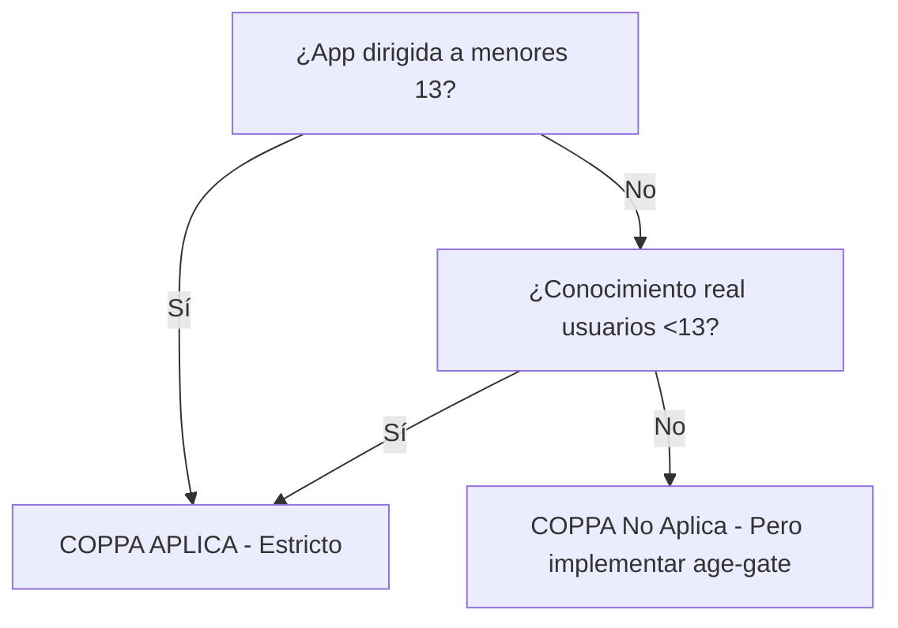

# SKILL: AUDITORÍA LEGAL Y COMPLIANCE (COPPA, GDPR, LOCAL)
**Versión:** 1.0 | **Activación:** `@skill legal-audit`

---

## 1. MARCO NORMATIVO APLICABLE POR DEFECTO

| Regulación | Ámbito | Aplicable Si | Referencia Key |
|------------|--------|--------------|----------------|
| **GDPR (UE 2016/679)** | UE/EEA + extraterritorial | Procesas datos de residentes UE | Art. 3, 5-32 |
| **LOPD-GDD (España)** | España | Operas en/españa o tratas datos ES | Arts. 5-9, 13, 30-34 |
| **CCPA/CPRA (California)** | California, USA | $25M+ revenue O 100K+ consumers | §1798.100-199 |
| **LGPD (Brasil)** | Brasil | Tratas datos de residentes BR | Arts. 7-16 |
| **COPPA (USA)** | USA Federal | **Menores 13 años** (dirigido o conocimiento real) | 15 USC 6501-6506 |
| **ePrivacy Directive** | UE | Cookies, marketing electrónico | Art. 5(3) |

### Regla de Oro: **Privacy by Design + Privacy by Default (GDPR Art. 25)**

---

## 2. COPPA — PROTECCIÓN MENORES 13 AÑOS (ZERO TOLERANCE)

### Criterios de Aplicación


### Requisitos Obligatorios COPPA
| Requisito | Implementación Técnica |
|-----------|------------------------|
| **Consentimiento paterno verificable** | Firma electrónica + verificación identidad (último 4 SSN, licencia conducir, video-call) |
| **Aviso directo a padres** | Email + postal antes de recopilar + cada cambio material |
| **Derecho revisión/eliminación** | Portal padres: ver datos, revocar consentimiento, solicitar borrado |
| **Limitación recopilación** | Solo datos "razonablemente necesarios" para la actividad |
| **Seguridad razonable** | Cifrado reposo/tránsito, acceso por roles, retención mínima |
| **No condicionar participación** | No exigir más datos de los necesarios para jugar/usar |

### Implementación Age-Gate (Patrón Seguro)
```typescript
// components/AgeGate.tsx
interface AgeGateResult {
  allowed: boolean;
  requiresParentalConsent: boolean;
  userAge: number;
}

function useAgeGate(birthDate: string): AgeGateResult {
  const age = calculateAge(birthDate);
  const isMinor = age < 13;

  if (isMinor) {
    // Flujo COPPA: redirigir a formulario consentimiento paterno
    return { allowed: false, requiresParentalConsent: true, userAge: age };
  }
  if (age >= 13 && age < 16) {
    // GDPR Art. 8: consentimiento padre si <16 (estado miembro puede bajar a 13)
    return { allowed: true, requiresParentalConsent: true, userAge: age };
  }
  return { allowed: true, requiresParentalConsent: false, userAge: age };
}
```

---

## 3. GDPR / LOPD-GDD — CHECKLIST TÉCNICO OBLIGATORIO

### A. Base Legal (Art. 6 GDPR) — Una POR Tratamiento
| Tratamiento | Base Legal | Evidencia Requerida |
|-------------|------------|---------------------|
| Registro usuario | Consentimiento (Art. 6.1.a) | Log consentimiento granular + timestamp + IP |
| Ejecución contrato | Ejecución contrato (Art. 6.1.b) | Términos aceptados + orden servicio |
| Facturación | Obligación legal (Art. 6.1.c) | Normativa fiscal aplicable |
| Marketing email | Interés legítimo (Art. 6.1.f) + Opt-out | LIA (Legitimate Interest Assessment) |
| Analytics | Consentimiento (ePrivacy) | Cookie banner granular |

### B. Derechos Titulares (Arts. 15-22) — API Endpoints Obligatorios
```python
# legal/compliance/gdpr_rights.py
from fastapi import APIRouter, Depends
from pydantic import BaseModel
from enum import Enum

router = APIRouter(prefix="/api/v1/gdpr", tags=["GDPR Rights"])

class RightType(str, Enum):
    ACCESS = "access"           # Art. 15
    RECTIFICATION = "rectification"  # Art. 16
    ERASURE = "erasure"         # Art. 17 (Right to be Forgotten)
    RESTRICTION = "restriction"      # Art. 18
    PORTABILITY = "portability"      # Art. 20
    OBJECTION = "objection"          # Art. 21

class GDPRRequest(BaseModel):
    right: RightType
    user_id: str
    verification_token: str  # Email/SMS verification
    details: dict | None = None

@router.post("/rights/exercise")
async def exercise_right(request: GDPRRequest):
    # 1. Verificar identidad (token + rate limit)
    # 2. Validar base legal del tratamiento afectado
    # 3. Ejecutar en < 30 días (Art. 12.3)
    # 4. Registrar en log auditoría
    # 5. Confirmar al usuario
    pass
```

### C. Registro de Actividades de Tratamiento (ROPA - Art. 30)
```json
// docs/legal/ropa.json
{
  "tratamientos": [
    {
      "nombre": "Gestión Usuarios MicroApp Citas",
      "responsable": "Tu Empresa SL",
      "delegado_proteccion_datos": "dpo@tuempresa.com",
      "finalidad": "Gestión citas médicas, recordatorios, historial clínico",
      "categorias_datos": [
        "Identificativos (nombre, email, teléfono)",
        "Datos de salud (historial, citas, especialidad)"  // Categoría especial Art. 9
      ],
      "base_legal": "Art. 6.1.b (contrato) + Art. 9.2.h (salud)",
      "destinatarios": ["Proveedor WhatsApp API", "Hosting EU", "Backup EU"],
      "transferencias_internacionales": false,
      "plazo_conservacion": "5 años tras última cita (obligación legal sanidad)",
      "medidas_seguridad": [
        "Cifrado AES-256 reposo",
        "TLS 1.3 tránsito",
        "Acceso por roles (RBAC)",
        "Logs auditoría inmutables",
        "Backups cifrados geo-redundantes EU"
      ],
      "evaluacion_impacto": true,  // DPIA obligatoria por datos salud
      "fecha_revision": "2026-10-08"
    }
  ]
}
```

### D. DPIA (Evaluación Impacto Protección Datos) — Obligatoria Si:
- Procesamiento sistemático a gran escala
- **Datos especiales (salud, biométricos, genéticos)** ← TU CASO
- Vigilancia sistemática zona pública
- Decisiones automatizadas con efectos jurídicos

---

## 4. COOKIES Y EPRIVACY — BANNER COMPLIANT

### Categorías Obligatorias
| Categoría | Finalidad | Consentimiento | Ejemplo |
|-----------|-----------|----------------|---------|
| **Necesarias** | Funcionamiento web | No (Art. 5.3 ePrivacy) | Session ID, CSRF, load balancer |
| **Preferencias** | Idioma, región, tema | Sí (GDPR Art. 7) | `locale=es`, `theme=dark` |
| **Analytics** | Medición audiencia | Sí | GA4, Matomo, Plausible |
| **Marketing** | Perfilado, ads | Sí | Meta Pixel, Google Ads, LinkedIn Insight |

### Implementación Técnica (Cookie Banner)
```typescript
// lib/cookies/consent-manager.ts
type ConsentCategory = 'necessary' | 'preferences' | 'analytics' | 'marketing';

interface ConsentState {
  necessary: true;  // Siempre true
  preferences: boolean;
  analytics: boolean;
  marketing: boolean;
  timestamp: string;
  version: string;
  ip_hash: string;  // Hash IP para prueba consentimiento
}

const CONSENT_VERSION = '2026.10.01';

function getConsent(): ConsentState | null {
  const stored = localStorage.getItem('cookie_consent');
  if (!stored) return null;
  const parsed = JSON.parse(stored);
  return parsed.version === CONSENT_VERSION ? parsed : null;
}

function setConsent(consent: Omit<ConsentState, 'necessary' | 'timestamp' | 'version' | 'ip_hash'>) {
  const full: ConsentState = {
    necessary: true,
    ...consent,
    timestamp: new Date().toISOString(),
    version: CONSENT_VERSION,
    ip_hash: await hashIP() // Server-side endpoint
  };
  localStorage.setItem('cookie_consent', JSON.stringify(full));
  applyConsent(full);
}

function applyConsent(consent: ConsentState) {
  // Cargar scripts condicionalmente
  if (consent.analytics) loadScript('/scripts/analytics.js');
  if (consent.marketing) loadScript('/scripts/marketing.js');
  // GTM/GA4 consent mode v2
  window.gtag('consent', 'update', {
    analytics_storage: consent.analytics ? 'granted' : 'denied',
    ad_storage: consent.marketing ? 'granted' : 'denied',
    ad_user_data: consent.marketing ? 'granted' : 'denied',
    ad_personalization: consent.marketing ? 'granted' : 'denied'
  });
}
```

---

## 5. FUENTES LOCALES Y SOBERANÍA DE DATOS

### Principio: **Zero Dependency on External CDNs para Assets Críticos**

| Recurso | ❌ Externo (Riesgo) | ✅ Local (Compliant) |
|---------|---------------------|----------------------|
| Fuentes (Google Fonts) | `fonts.googleapis.com` | Self-host: `/fonts/Inter.woff2` |
| Iconos (FontAwesome CDN) | `cdn.fontawesome.com` | SVG inline / `/icons/*.svg` |
| JS Libraries (jQuery CDN) | `code.jquery.com` | `npm install` + bundle |
| Analytics (GA4) | `googletagmanager.com` | **Matomo/Plausible self-hosted EU** |
| Maps (Google Maps) | `maps.googleapis.com` | **MapLibre + OpenStreetMap tiles EU** |
| ReCAPTCHA | `google.com/recaptcha` | **Turnstile (Cloudflare) / hCaptcha EU / mCaptcha self-hosted** |

### Auditoría Automatizada (CI Gate)
```yaml
# .github/workflows/legal-compliance.yml
name: Legal Compliance Audit
on: [push, pull_request]
jobs:
  audit:
    runs-on: ubuntu-latest
    steps:
      - uses: actions/checkout@v4
      - name: Scan external domains
        run: |
          # Detectar llamadas a dominios no permitidos en build
          npm run build 2>&1 | grep -E "(googleapis|fontawesome|googletagmanager|recaptcha|facebook\.net)" && exit 1 || true
      - name: Check cookie consent implementation
        run: |
          test -f "components/CookieBanner.tsx" || exit 1
          grep -r "consent_mode_v2" . || exit 1
      - name: Verify ROPA exists
        run: test -f "docs/legal/ropa.json" || exit 1
      - name: Verify DPIA for health data
        run: test -f "docs/legal/dpia.md" || exit 1
```

---

## 6. CONTRATOS Y DPA (DATA PROCESSING AGREEMENTS)

### Proveedores Requeridos DPA (Art. 28 GDPR)
| Proveedor | Tipo | DPA Firmado | Ubicación Datos |
|-----------|------|-------------|-----------------|
| Hosting (Vercel/AWS/Hetzner) | Subprocesador | ✅ Obligatorio | EU (Frankfurt/Paris/Madrid) |
| Email (Resend/SendGrid/Mailgun) | Subprocesador | ✅ Obligatorio | EU disponible |
| WhatsApp API (Meta/Twilio/360dialog) | Subprocesador | ✅ Obligatorio | Verificar cláusulas contractuales tipo |
| Database (Supabase/Neon/Planetscale) | Subprocesador | ✅ Obligatorio | EU regions only |
| Analytics (Matomo Cloud/Plausible) | Subprocesador | ✅ Obligatorio | EU only |

### Cláusulas Mínimas DPA (Verificar en cada contrato)
- [ ] Instrucciones documentadas del responsable
- [ ] Confidencialidad personal autorizado
- [ ] Medidas seguridad Art. 32
- [ ] Subprocesadores: lista + notificación previa + mismo nivel protección
- [ ] Derechos titulares: asistencia al responsable
- [ ] Supresión/devolución datos fin servicio
- [ ] Auditorías e inspecciones
- [ ] Transferencias internacionales: SCC 2021 + transfer impact assessment

---

## 7. RETENCIÓN Y SUPRESIÓN DE DATOS

### Políticas por Categoría
| Categoría Dato | Plazo Retención | Base Legal | Acción Fin Plazo |
|----------------|-----------------|------------|------------------|
| Datos cuenta usuario | 5 años post-baja | Art. 6.1.b + obligaciones fiscales | Anonimización (pseudonimización irreversible) |
| Historial citas salud | 5-10 años (según ley sanidad autonómica) | Art. 9.2.h + ley sectorial | Bloqueo + supresión segura |
| Logs auditoría/acceso | 2 años | Interés legítimo seguridad | Supresión automática |
| Cookies analytics | 14 meses (GA4) / 13 meses (ePrivacy ES) | Consentimiento | Expiración automática |
| Leads marketing | 3 años sin interacción | Interés legítimo + opt-out | Supresión + supresión lista supresión |

### Job Automatizado (Cron)
```python
# jobs/data_retention.py
import asyncio
from datetime import datetime, timedelta
from sqlalchemy import delete, and_

async def retention_job():
    async with get_session() as db:
        # Usuarios inactivos 5 años + sin obligaciones legales pendientes
        cutoff = datetime.utcnow() - timedelta(days=5*365)
        inactive_users = await db.execute(
            select(User).where(
                and_(
                    User.last_activity < cutoff,
                    User.legal_holds == 0,
                    User.deleted_at.is_(None)
                )
            )
        )
        for user in inactive_users.scalars():
            await anonymize_user(user.id)  # Pseudonimización irreversible
            user.deleted_at = datetime.utcnow()
        await db.commit()
```

---

## 8. CHECKLIST DE ENTREGA LEGAL (Definition of Done)

- [ ] ROPA (`docs/legal/ropa.json`) completo y actualizado
- [ ] DPIA (`docs/legal/dpia.md`) realizada y firmada por DPO
- [ ] Age-gate COPPA implementado + flujo consentimiento paterno
- [ ] Cookie Banner v2 (GA4 consent mode) funcional + granular
- [ ] 0 dependencias CDN externas críticas (fuentes, iconos, analytics self-hosted)
- [ ] Endpoints GDPR Rights (Arts. 15-22) implementados y testeados
- [ ] DPAs firmados con todos los subprocesadores
- [ ] Job retención/supresión automatizado + logs auditoría
- [ ] CI Gate compliance pasando (external domains, ROPA, DPIA, cookie banner)
- [ ] Privacy Policy + Terms of Service enlazados en footer + idioma usuario