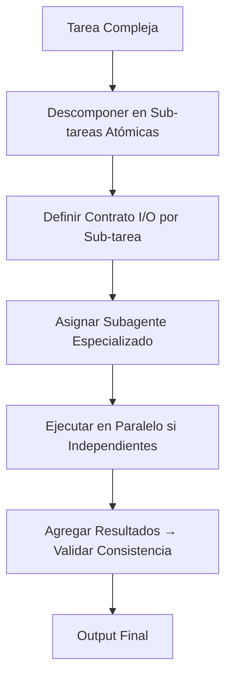
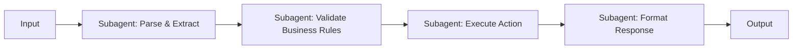
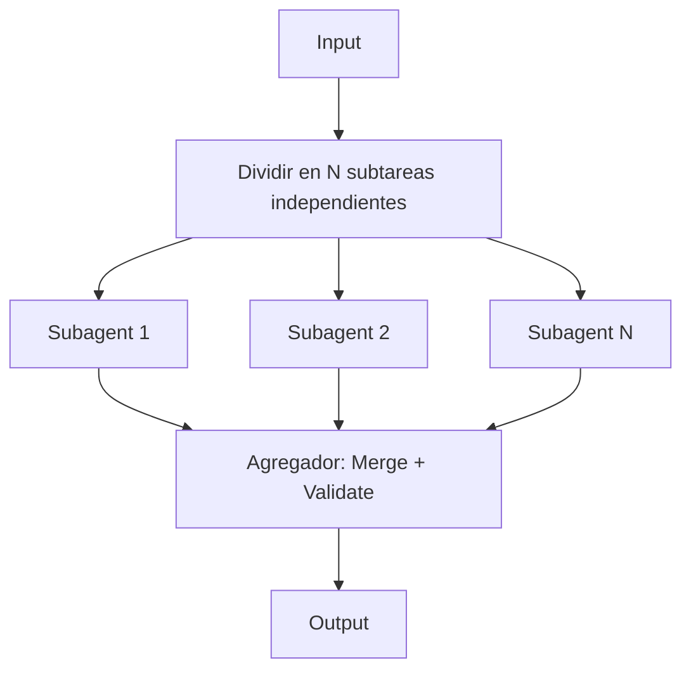
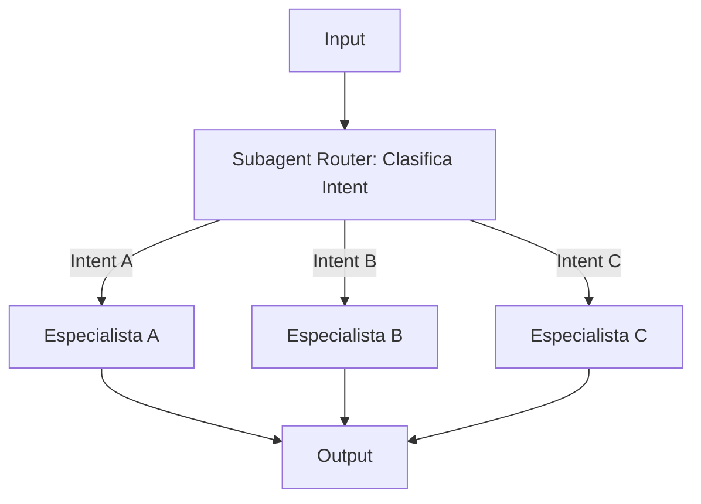

# SKILL: META-PROMPTS NIDHINJS
**Versión:** 1.0 | **Activación:** `@skill meta-prompts`

---

## 1. PATRONES DE DESCOMPOSICIÓN ANALÍTICA PARA SUBAGENTES

### Principio: **Una Tarea = Un Subagente = Un Output Determinista**



### Template de Prompt para Subagente (System Prompt Estándar)
```markdown
# SYSTEM PROMPT: [NOMBRE SUBAGENTE - ROL ESPECÍFICO]

## 1. MISIÓN ÚNICA
[Una frase: qué hace y qué NO hace]

## 2. CONTRATO DE ENTRADA (INPUT SCHEMA)
```json
{
  "type": "object",
  "properties": {
    "campo1": { "type": "string", "description": "..." },
    "campo2": { "type": "array", "items": { "type": "string" } }
  },
  "required": ["campo1"]
}
```

## 3. CONTRATO DE SALIDA (OUTPUT SCHEMA)
```json
{
  "type": "object",
  "properties": {
    "resultado": { "type": "string" },
    "metadata": { "type": "object" }
  },
  "required": ["resultado"]
}
```

## 4. REGLAS OPERATIVAS (NEGATIVE CONSTRAINTS)
- NO hagas [acción prohibida]
- NO asumas [contexto externo no provisto]
- NO generes [formato no solicitado]
- SIEMPRE valida [regla crítica] antes de responder

## 5. FEW-SHOT EXAMPLES (2-3 CASOS)
### Input 1:
```json
{ "campo1": "valor", "campo2": ["a", "b"] }
```
### Output 1:
```json
{ "resultado": "output esperado", "metadata": {} }
```

## 6. CRITERIO DE ÉXITO
Output válido según schema + reglas operativas + consistencia con examples.
```

---

## 2. REGLAS DE RESTRICCIONES NEGATIVAS (CRÍTICAS)

### Patrón: `NO [verbo] [condición] → SI [condición] ENTONCES [acción correctiva]`

| Regla | Aplicación |
|-------|------------|
| `NO alucines datos` | SI faltan datos en input → `RESPONDE: "INPUT_INCOMPLETE: campo X requerido"` |
| `NO inventes APIs` | SI endpoint no documentado → `RESPONDE: "UNKNOWN_ENDPOINT: usa solo contratos provistos"` |
| `NO uses librerías no aprobadas` | SI dependencia no en `package.json`/`requirements.txt` → `RESPONDE: "UNAPPROVED_DEP: librería X no permitida"` |
| `NO rompas contratos` | SI output no valida schema → `REINTENTA con corrección automática (max 2)` |
| `NO mezcles responsabilidades` | SI tarea requiere 2 dominios → `DIVIDE en 2 subagentes` |
| `NO ignores errores` | SI excepción → `CAPTURA → LOG estructurado → RETORNA error tipado` |

### Implementación en Código (Guardrails)
```python
# meta_prompts/guardrails.py
from pydantic import BaseModel, ValidationError
from typing import TypeVar, Type

T = TypeVar('T', bound=BaseModel)

def enforce_output_schema(output: dict, schema: Type[T], max_retries: int = 2) -> T:
    """Valida output contra schema Pydantic. Reintenta con feedback si falla."""
    for attempt in range(max_retries + 1):
        try:
            return schema(**output)
        except ValidationError as e:
            if attempt == max_retries:
                raise ValueError(f"SCHEMA_VIOLATION after {max_retries} retries: {e}")
            # Feedback automático al LLM para auto-corrección
            output = request_llm_correction(output, e.errors(), schema)
    raise RuntimeError("Unreachable")
```

---

## 3. FEW-SHOT PROMPTING — EJEMPLOS BREVES PARA SALIDAS DETERMINISTAS

### Regla de Oro: **2-3 Examples Mínimos, Máxima Diversidad de Casos Edge**

#### Estructura Few-Shot Estándar
```markdown
## EXAMPLES (Few-Shot)

### Example 1: Caso Nominal (Happy Path)
**Input:**
```json
{ "user_query": "Crear recordatorio para cita mañana 10am", "context": {} }
```
**Output:**
```json
{
  "action": "create_reminder",
  "params": { "datetime": "2026-10-09T10:00:00", "channel": "whatsapp" },
  "confidence": 0.98
}
```

### Example 2: Caso Ambigüedad (Clarification Required)
**Input:**
```json
{ "user_query": "Recuérdame lo de mañana", "context": { "pending_appointments": 3 } }
```
**Output:**
```json
{
  "action": "ask_clarification",
  "question": "Tienes 3 citas mañana. ¿Cuál recordatorio activar?",
  "options": ["Cita 1: 09:00 - Dr. Pérez", "Cita 2: 11:30 - Dra. López", "Cita 3: 16:00 - Kinesio"]
}
```

### Example 3: Caso Error / Fuera de Alcance
**Input:**
```json
{ "user_query": "Compra entradas para concierto", "context": {} }
```
**Output:**
```json
{
  "action": "reject",
  "reason": "OUT_OF_SCOPE: Solo gestiono recordatorios de citas médicas",
  "suggestion": "Puedo ayudarte con: crear/cancelar/listar recordatorios de citas"
}
```

---

## 4. PATRONES DE DESCOMPOSICIÓN COMUNES

### A. Pipeline Secuencial (Chain of Thought Explícito)


### B. Paralelo con Agregación (Map-Reduce)


### C. Router + Specialists (Mixture of Experts)


---

## 5. CHAIN-OF-THOUGHT (CoT) ESTRUCTURADO — PARA RAZONAMIENTO COMPLEJO

### Prompt Template CoT
```markdown
## REASONING PROTOCOL (Chain-of-Thought)

Antes de generar el output final, PIENSA PASO A PASO en bloque <reasoning>:

<reasoning>
PASO 1: Identificar la intención principal del input
PASO 2: Verificar precondiciones (datos requeridos, permisos, estado)
PASO 3: Evaluar reglas de negocio aplicables
PASO 4: Determinar acción(es) y parámetros exactos
PASO 5: Anticipar efectos secundarios / validaciones necesarias
PASO 6: Construir output según schema
</reasoning>

## OUTPUT FINAL (Solo JSON válido según schema)
```

### Self-Consistency (Para Decisiones Críticas)
```python
# Ejecutar 3 veces con temperature=0.3, tomar mayoría
def self_consistency_decision(prompt: str, schema: Type[T], n: int = 3) -> T:
    results = [call_llm(prompt, temperature=0.3) for _ in range(n)]
    # Votación simple por serialización JSON
    return most_common(results, key=lambda x: json.dumps(x, sort_keys=True))
```

---

## 6. EVALUACIÓN Y MÉTRICAS DE PROMPTS

### Métricas Clave (Trackear por Subagente)
| Métrica | Target | Herramienta |
|---------|--------|-------------|
| **Schema Validity Rate** | 100% | Pydantic validation |
| **Negative Constraint Violations** | 0 | Automated tests |
| **Latency (p99)** | < 2s | LangSmith / custom |
| **Token Efficiency** | < 2000 tokens/turn | Token counter |
| **Hallucination Rate** | 0% | Ground truth eval set |

### Eval Set Mínimo por Subagente (10 casos)
- 5 Happy Path
- 2 Edge Cases (ambigüedad, datos faltantes)
- 2 Out of Scope
- 1 Adversarial (injection attempt)

---

## 7. CHECKLIST DE ENTREGA META-PROMPT (Definition of Done)

- [ ] System prompt sigue template estándar (Misión, I/O Schema, Reglas, Few-Shot, Éxito)
- [ ] Reglas negativas cubren: alucinación, APIs fantasmas, deps no aprobadas, contratos, responsabilidades, errores
- [ ] 2-3 Few-shots cubren: Happy path, Ambigüedad, Fuera de alcance
- [ ] Patrón de descomposición documentado (Secuencial / Paralelo / Router)
- [ ] CoT estructurado si tarea requiere razonamiento > 2 pasos
- [ ] Self-consistency configurado para decisiones críticas
- [ ] Eval set de 10 casos creado y passing
- [ ] Guardrails de validación Pydantic implementados