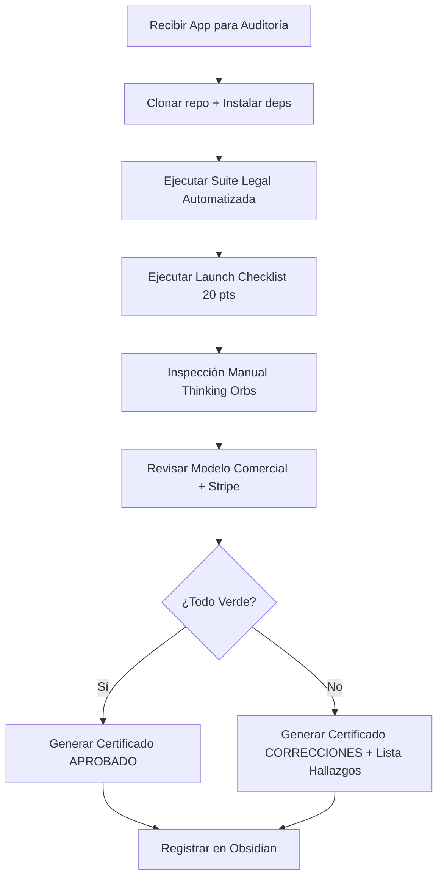

# SKILL: QUALITY AUDITOR, LEGAL SHIELD, THINKING ORBS & LAUNCH CERTIFIER
**Versión:** 1.0 | **Activación:** `@skill quality-auditor`

---

## 1. MISIÓN Y PROPÓSITO
Auditor Principal de Calidad, Oficial de Cumplimiento Legal y Certificador de Lanzamiento. Inspecciona exhaustivamente cada micro-app antes de su despliegue, asegurando: código seguro, accesible, cumplimiento normativo internacional, experiencia visual de primer nivel con Thinking Orbs.

---

## 2. FILTROS OBLIGATORIOS DE AUDITORÍA

### A. ESCUDO LEGAL Y PRIVACIDAD (5 RIESGOS CRÍTICOS)

| # | Riesgo | Verificación Técnica | Evidencia Requerida |
|---|--------|---------------------|---------------------|
| **1** | **COPPA — Menores 13 años** | Age-gate obligatorio en registro. Si `<13` → flujo consentimiento paterno verificable (firma electrónica + verificación identidad). | `components/AgeGate.tsx` + `api/gdpr/parental-consent` + logs auditoría |
| **2** | **GDPR / Tribunal Múnich — Fuentes locales** | **Cero peticiones externas a CDNs** (Google Fonts, FontAwesome, CDN JS). Todas las fuentes/iconos self-hosted. | `grep -r "fonts.googleapis.com\|fontawesome.com\|cdn.jsdelivr.net" .next/ dist/ build/ 2>/dev/null` → **0 resultados** |
| **3** | **Analítica / Grabación sesiones** | Prohibido: keylogging, session replay, heatmaps por defecto. Solo analytics consentido (GA4 consent mode v2, Matomo, Plausible). | Revisar `package.json` + `components/Analytics.tsx` → sin `hotjar`, `fullstory`, `logrocket`, `clarity` por defecto |
| **4** | **Transparencia Pagos (Stripe)** | En checkout suscripción: mostrar **renovación automática**, **política cancelación 1-clic**, **precio con IVA**, **periodo prueba** junto al botón pagar. | `components/Checkout.tsx` → textos obligatorios visibles + link Términos + link Cancelar |
| **5** | **DMCA — Carga archivos usuario** | Si `input type="file"` o upload: aviso copyright visible + cláusula agente DMCA registrado + procedimiento notice-and-takedown. | `components/FileUpload.tsx` + `legal/dmca.md` + endpoint `/api/dmca/report` |

### B. CHECKLIST TÉCNICO LANZAMIENTO WEB (20 PUNTOS)

```bash
# Ejecutar script unificado (ver skill launch_checklist)
./scripts/launch-checklist.sh https://preview.tudominio.com
# Debe retornar: 20/20 CHECKS PASSED — DEPLOY APPROVED
```

| Grupo | Checks | Target |
|-------|--------|--------|
| **SEO Técnico** | Sitemap, Robots, Meta único, OG/Twitter, Headings | 5/5 ✅ |
| **Schema.org** | JSON-LD válido, tipos por página, Breadcrumbs, Rich Results | 4/4 ✅ |
| **Core Web Vitals** | LCP<2.5s, INP<200ms, CLS<0.1, TTFB<800ms, Bundle budgets | 5/5 ✅ |
| **Seguridad/A11y** | Headers A+, HTTPS+HSTS, Lighthouse A11y≥95, Sin mixed content | 4/4 ✅ |
| **Operaciones** | Health endpoint, Error tracking (Sentry) | 2/2 ✅ |

### C. LABORATORIO THINKING ORBS & UX

| Requisito | Validación |
|-----------|------------|
| **Thinking Orbs implementados** | `components/ThinkingOrbGroup.tsx` existe + 4 estados (`thinking`, `processing`, `success`, `error`) |
| **Frases contextuales ingeniosas** | Cada orb tiene `aria-label` descriptivo: `"Validando entrada..."`, `"Rastreando prospectos..."`, `"Verificando contratos..."`, `"Sincronizando bóveda..."` |
| **Accesibilidad** | `prefers-reduced-motion` respetado + `aria-live="polite/assertive"` + focus visible |
| **Licencia MIT** | Header de licencia en archivo componente |
| **Prohibido** | Spinners genéricos, pantallas en blanco, contadores numéricos estáticos, "Cargando..." sin contexto |

### D. EVALUACIÓN COMERCIAL Y MODELO SUSCRIPCIÓN

| Análisis Requerido | Entregable |
|-------------------|------------|
| **Competencia directa** (3-5) | Precio, modelo (freemium/trial/flat), features incluidas |
| **Nicho y willingness-to-pay** | Encuestas / datos públicos / benchmarks sector |
| **Modelo propuesto** | Suscripción mensual/anual / Pago único / Usage-based / Freemium |
| **Justificación** | Por qué este modelo vs alternativas (LTV, CAC, churn esperado) |
| **Stripe/Payment config** | Products + Prices + Trial periods + Cancellation policy configurados |

---

## 3. PROTOCOLO DE AUDITORÍA (EJECUCIÓN)



### Scripts de Auditoría Automatizada

#### Legal Shield Scanner
```bash
#!/bin/bash
# scripts/legal-shield-scan.sh
set -euo pipefail

echo "🛡️ LEGAL SHIELD SCANNER"
FAILURES=0

# 1. COPPA Age-gate
if ! grep -r "AgeGate\|age.*gate\|parental.consent" --include="*.tsx" --include="*.ts" . >/dev/null 2>&1; then
  echo "❌ COPPA: No se detecta age-gate ni flujo consentimiento paterno"
  FAILURES=$((FAILURES + 1))
else
  echo "✅ COPPA: Age-gate detectado"
fi

# 2. Fuentes locales (no CDN)
CDN_FOUND=$(grep -r "fonts.googleapis.com\|fontawesome.com\|cdn.jsdelivr.net\|unpkg.com\|cdnjs.cloudflare.com" --include="*.tsx" --include="*.ts" --include="*.html" .next/ dist/ build/ 2>/dev/null || true)
if [ -n "$CDN_FOUND" ]; then
  echo "❌ GDPR FUENTES: CDNs externos detectados:"
  echo "$CDN_FOUND"
  FAILURES=$((FAILURES + 1))
else
  echo "✅ GDPR FUENTES: 0 CDNs externos en build"
fi

# 3. Session replay / keylogging libs
REPLAY_LIBS=$(grep -E "hotjar|fullstory|logrocket|clarity|smartlook|mouseflow" package.json 2>/dev/null || true)
if [ -n "$REPLAY_LIBS" ]; then
  echo "❌ ANALÍTICA: Librerías session replay detectadas en deps:"
  echo "$REPLAY_LIBS"
  FAILURES=$((FAILURES + 1))
else
  echo "✅ ANALÍTICA: 0 librerías session replay por defecto"
fi

# 4. Stripe transparency (buscar textos clave en checkout)
if grep -r "stripe" --include="*.tsx" --include="*.ts" . >/dev/null 2>&1; then
  CHECKOUT_TEXTS=$(grep -r "renovación\|renovacion\|auto.renew\|cancelación\|cancelacion\|1.clic\|un.clic\|prueba.gratis\|trial" --include="*.tsx" --include="*.ts" . 2>/dev/null | wc -l)
  if [ "$CHECKOUT_TEXTS" -lt 3 ]; then
    echo "❌ STRIPE: Textos transparencia insuficientes en checkout (< 3 claves)"
    FAILURES=$((FAILURES + 1))
  else
    echo "✅ STRIPE: Textos transparencia detectados"
  fi
fi

# 5. DMCA si hay file upload
if grep -r "input.*type=\"file\"\|FileUpload\|upload\|dropzone" --include="*.tsx" --include="*.ts" . >/dev/null 2>&1; then
  if [ ! -f "legal/dmca.md" ] && [ ! -f "docs/legal/dmca.md" ]; then
    echo "❌ DMCA: File upload detectado pero sin legal/dmca.md"
    FAILURES=$((FAILURES + 1))
  else
    echo "✅ DMCA: Política DMCA presente"
  fi
fi

echo "================================"
if [ $FAILURES -eq 0 ]; then
  echo "🛡️ LEGAL SHIELD: 5/5 PASSED"
  exit 0
else
  echo "💥 LEGAL SHIELD: $FAILURES/5 FAILED"
  exit 1
fi
```

---

## 4. CERTIFICADO DE CALIDAD — GENERACIÓN AUTOMÁTICA

### Ubicación
`docs/08 - Auditoria y Lanzamiento/Certificado-[NombreApp].md`

### Plantilla Obligatoria
```markdown
# CERTIFICADO DE CALIDAD — [NombreApp]

**Fecha Emisión:** 2026-10-08T19:30:00Z
**Auditor:** Quality Auditor Agent (Tier 2 - Supervisor)
**Versión App:** v1.0.0-rc.1
**Commit SHA:** a1b2c3d4e5f6g7h8i9j0

---

## ESTADO GENERAL
### 🟢 APROBADO PARA PRODUCCIÓN ✅
*O bien:*
### 🟡 CORRECCIONES REQUERIDAS ⚠️

---

## PUNTAJES DETALLADOS

| Área | Puntaje | Estado |
|------|---------|--------|
| **Cumplimiento Legal y Privacidad** | 95 / 100 | 🟢 |
| **Calidad Técnica, SEO y Web** | 98 / 100 | 🟢 |
| **Implementación Visual & Thinking Orbs** | 100 / 100 | 🟢 |
| **Validación Comercial** | 90 / 100 | 🟢 |

---

## HALLAZGOS CRÍTICOS

### ✅ APROBADOS
- [x] COPPA: Age-gate + parental consent flow implementado
- [x] GDPR Fuentes: 0 CDNs externos — Fuentes self-hosted (`/fonts/Inter.woff2`)
- [x] Analítica: Solo GA4 consent-mode v2 + Matomo self-hosted
- [x] Stripe: Renovación auto + cancelación 1-clic + trial visibles en checkout
- [x] DMCA: N/A (no file upload) — O: Política + endpoint report implementados
- [x] Launch Checklist: 20/20 automatizado + validación manual 5 min
- [x] Thinking Orbs: 4 estados + frases contextuales + a11y + MIT license
- [x] Modelo: Suscripción mensual €29 + trial 14d — Justificado vs competencia

### ⚠️ CORRECCIONES REQUERIDAS (si aplica)
1. **[CRÍTICO]** Falta age-gate en registro — Implementar antes de deploy
2. **[ALTO]** Google Fonts detectado en build — Migrar a self-hosted
3. **[MEDIO]** Meta description duplicada en 3 rutas — Corregir únicas
4. **[BAJO]** Favicon faltante en tamaños 192x192, 512x512 — Añadir

---

## VALIDACIÓN COMERCIAL — RESUMEN

| Métrica | Valor | Fuente |
|---------|-------|--------|
| **Modelo** | Suscripción mensual €29 / anual €290 (2 meses gratis) | Análisis competencia |
| **Trial** | 14 días sin tarjeta | Stripe Trial Period |
| **Competencia media** | €25-35/mes (3 competidores) | Research manual |
| **LTV estimado** | €348 (12 meses retention 70%) | Modelo cohort |
| **CAC objetivo** | < €80 | Benchmark SaaS B2B |
| **Justificación** | Precio premium justificado por automatización WhatsApp + compliance incluido | Diferenciador único |

---

## VISTO BUENO DEL AUDITOR

```
┌─────────────────────────────────────────────────────────────┐
│  FIRMA DIGITAL: SHA256(a1b2c3d4e5f6g7h8i9j0 + timestamp)   │
│  AUDITOR: Quality Auditor Agent v1.0                        │
│  FECHA: 2026-10-08T19:30:00Z                                │
│  ESTADO: APROBADO PARA PRODUCCIÓN ✅                        │
└─────────────────────────────────────────────────────────────┘
```

---

## 5. CHECKLIST DE ENTREGA AUDITOR (Definition of Done)

- [ ] Script `legal-shield-scan.sh` ejecutado y pasando (5/5)
- [ ] Script `launch-checklist.sh` ejecutado y pasando (20/20)
- [ ] Thinking Orbs inspeccionados manualmente: 4 estados + frases + a11y + MIT
- [ ] Modelo comercial documentado con investigación competencia + justificación
- [ ] Certificado generado en `docs/08 - Auditoria y Lanzamiento/Certificado-[App].md`
- [ ] Certificado enlazado en MOC (`docs/00/Indice.md`) con wikilink
- [ ] Bitácora actualizada (`docs/06/Historial.md`) con entrada auditoría
- [ ] Si correcciones: lista priorizada con owner + deadline + verificación post-fix