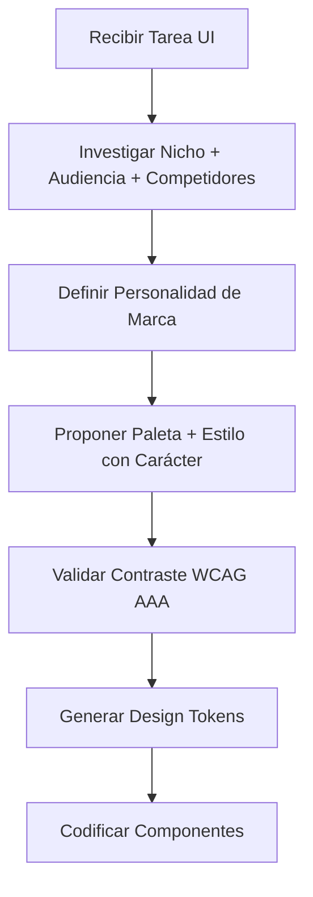

# SKILL: UI/UX NEXTLEVELBUILDER
**Versión:** 1.0 | **Licencia:** MIT | **Activación:** `@skill ui-ux`

---

## 1. PROTOCOLO DE DESCUBRIMIENTO (OBLIGATORIO ANTES DE CODIFICAR)



### Checklist de Investigación Mínima
- [ ] **Nicho:** ¿Qué problema resuelve la micro-app? ¿Sector vertical?
- [ ] **Audiencia:** ¿Quién usa la app? (Edad, rol, contexto de uso, device principal)
- [ ] **Competidores:** 3 referentes directos → analizar sus paletas, tipografías, patrones de interacción
- [ ] **Diferenciador visual:** ¿Qué emoción debe evocar? (Confianza, velocidad, calma, energía, precisión)

### Regla de Oro: **NUNCA AZUL POR DEFECTO**
| Personalidad | Paleta Base (Ejemplo) | Evitar |
|--------------|----------------------|--------|
| Clínica/Salud | Teal/Sage + Warm Gray | Azul hospitalario genérico |
| FinTech/Trust | Deep Indigo + Gold Accent | Azul corporativo estándar |
| Developer Tools | Dark Charcoal + Electric Green/Amber | GitHub/GitLab lookalike |
| Creative/Playful | Coral + Navy + Cream | Pastel genérico |
| High-Performance | Slate + Cyan + Warning Orange | Bootstrap defaults |

---

## 2. THINKING ORBS — ESTADOS DE ESPERA ANIMADOS (MIT LICENSE)

### Especificación Técnica
```typescript
// Componente base: ThinkingOrb.tsx
type OrbState = 'thinking' | 'processing' | 'success' | 'error';

interface ThinkingOrbProps {
  state: OrbState;
  size?: 'sm' | 'md' | 'lg'; // 24px | 40px | 64px
  label?: string;             // Texto accesible (sr-only)
  ariaLive?: 'polite' | 'assertive';
}
```

### Comportamiento por Estado

| Estado | Animación CSS | Color (Tokens) | Accesibilidad |
|--------|---------------|----------------|---------------|
| `thinking` | Pulse suave 1.5s infinite + rotación lenta 4s | `--orb-thinking: var(--color-primary-muted)` | `aria-live="polite"` "Procesando..." |
| `processing` | Spin 1s linear infinite + scale pulse 0.8s | `--orb-processing: var(--color-primary)` | `aria-live="polite"` "Ejecutando..." |
| `success` | Scale 0→1.2→1 (300ms ease-out) + checkmark draw | `--orb-success: var(--color-green-500)` | `aria-live="polite"` "Completado" |
| `error` | Shake horizontal 400ms + pulso rojo 2x | `--orb-error: var(--color-red-500)` | `aria-live="assertive"` "Error: {mensaje}" |

### Implementación CSS (Tailwind + CSS Variables)
```css
/* design-tokens.css */
:root {
  --orb-thinking:  var(--color-primary-400);
  --orb-processing: var(--color-primary-500);
  --orb-success:   var(--color-green-500);
  --orb-error:     var(--color-red-500);
  --orb-bg:        var(--color-surface);
  --orb-duration-fast: 150ms;
  --orb-duration-base: 300ms;
  --orb-duration-slow: 500ms;
}

.thinking-orb {
  @apply relative inline-flex items-center justify-center rounded-full
         transition-colors duration-300;
  width: var(--orb-size); height: var(--orb-size);
  background: var(--orb-bg);
  box-shadow: 0 0 0 2px var(--orb-color), 0 4px 12px -2px var(--orb-color);
}

.thinking-orb::before {
  content: ''; @apply absolute rounded-full;
  width: 100%; height: 100%;
  background: currentColor;
  opacity: 0.15;
}

.thinking-orb[data-state="thinking"] {
  animation: orb-pulse 1.5s ease-in-out infinite, orb-rotate 4s linear infinite;
}
.thinking-orb[data-state="processing"] {
  animation: orb-spin 1s linear infinite, orb-pulse 0.8s ease-in-out infinite;
}
.thinking-orb[data-state="success"] {
  animation: orb-pop 300ms ease-out forwards;
}
.thinking-orb[data-state="error"] {
  animation: orb-shake 400ms ease-in-out, orb-pulse 200ms 2;
}

@keyframes orb-pulse { 0%,100% { opacity: 0.6; transform: scale(1); } 50% { opacity: 1; transform: scale(1.05); } }
@keyframes orb-rotate { from { transform: rotate(0deg); } to { transform: rotate(360deg); } }
@keyframes orb-spin { from { transform: rotate(0deg); } to { transform: rotate(360deg); } }
@keyframes orb-pop { 0% { transform: scale(0); } 60% { transform: scale(1.2); } 100% { transform: scale(1); } }
@keyframes orb-shake { 0%,100% { transform: translateX(0); } 25% { transform: translateX(-4px); } 75% { transform: translateX(4px); } }
```

### Uso en Cockpit Horizontal
```tsx
// CockpitOrbs.tsx — Grupo horizontal de 3 orbs sincronizados
<ThinkingOrbGroup>
  <ThinkingOrb state={step1State} label="Validando entrada" />
  <ThinkingOrb state={step2State} label="Procesando lógica" />
  <ThinkingOrb state={step3State} label="Sincronizando bóveda" />
</ThinkingOrbGroup>
```

---

## 3. JERARQUÍA TIPOGRÁFICA ACCESIBLE (WCAG AAA)

### Escala Modular (Ratio 1.25 — Major Third)
| Token | Tamaño | Line Height | Uso | Contraste Mínimo |
|-------|--------|-------------|-----|------------------|
| `--text-display` | 3.5rem (56px) | 1.1 | Hero headline | 7:1 |
| `--text-h1` | 2.5rem (40px) | 1.2 | Page title | 7:1 |
| `--text-h2` | 2rem (32px) | 1.3 | Section title | 7:1 |
| `--text-h3` | 1.5rem (24px) | 1.4 | Subsection | 7:1 |
| `--text-body-lg` | 1.125rem (18px) | 1.6 | Lead paragraph | 7:1 |
| `--text-body` | 1rem (16px) | 1.6 | Body text | 7:1 |
| `--text-sm` | 0.875rem (14px) | 1.5 | Meta, captions | 7:1 |
| `--text-xs` | 0.75rem (12px) | 1.5 | Legal, timestamps | 4.5:1 |

### Tokens de Color (Contraste AAA Garantizado)
```css
:root {
  /* Superficies */
  --color-surface:       #FAFAFA;   /* --text-body: #1A1A2E → 15.3:1 */
  --color-surface-alt:   #F0F0F5;   /* --text-body: #1A1A2E → 12.8:1 */
  --color-surface-dark:  #1A1A2E;   /* --text-body-inverse: #FAFAFA → 15.3:1 */

  /* Texto */
  --text-primary:   #1A1A2E;   /* Sobre surface: 15.3:1 ✓ AAA */
  --text-secondary: #3D3D5C;   /* Sobre surface: 9.2:1  ✓ AAA */
  --text-muted:     #6B6B8A;   /* Sobre surface: 5.8:1  ✓ AA Large */
  --text-inverse:   #FAFAFA;   /* Sobre dark: 15.3:1 ✓ AAA */

  /* Primaria (ejemplo: Indigo + Gold para FinTrust) */
  --color-primary-50:  #EEF0FA;
  --color-primary-100: #DCE0F5;
  --color-primary-400: #6B7CE8;  /* Muted orb */
  --color-primary-500: #4A5BD8;  /* Processing orb */
  --color-primary-600: #3A4ACC;  /* Hover */
  --color-primary-700: #2D3BB8;  /* Active */

  /* Semánticos */
  --color-green-500:  #10B981;  /* Success orb — 7.1:1 sobre white */
  --color-red-500:    #EF4444;  /* Error orb — 5.5:1 sobre white (AA Large) */
  --color-amber-500:  #F59E0B;  /* Warning */
}
```

### Reglas de Implementación
1. **Rem-based spacing:** `space-y-4` → `1rem` base, escala modular
2. **Focus visible obligatorio:** `focus-visible:ring-2 focus-visible:ring-offset-2 focus-visible:ring-primary-500`
3. **Reduced motion:** `@media (prefers-reduced-motion: reduce) { .thinking-orb { animation: none !important; } }`
4. **Dark mode first:** Definir tokens para ambos temas simultáneamente

---

## 4. MICRO-INTERACCIONES CORE (MIT)

| Interacción | Duración | Easing | Propósito |
|-------------|----------|--------|-----------|
| Button press | 100ms | `cubic-bezier(0.4, 0, 0.2, 1)` | Feedback táctil inmediato |
| Card hover lift | 200ms | `ease-out` | Descubrimiento de profundidad |
| Form field focus | 150ms | `ease-out` | Guía visual de foco |
| Toast/snackbar enter | 300ms | `cubic-bezier(0.34, 1.56, 0.64, 1)` | Entrada elástica (pop-in) |
| Modal/backdrop fade | 200ms | `ease-in-out` | Transición de contexto |
| Page transition (Next.js) | 250ms | `ease-in-out` | Navegación fluida |

---

## 5. CHECKLIST DE ENTREGA UI (Definition of Done)

- [ ] Paleta propuesta tras investigación de nicho (no azul por defecto)
- [ ] Tokens CSS generados (`design-tokens.css` + `tailwind.config.ts`)
- [ ] ThinkingOrbs implementados y testeados en 4 estados
- [ ] Contraste WCAG AAA verificado en todos los pares texto/fondo
- [ ] `prefers-reduced-motion` respetado
- [ ] Dark mode funcional sin flash
- [ ] Componentes Storybook documentados con controles de estado
- [ ] Tests visuales (Chromatic/Playwright) para regresión