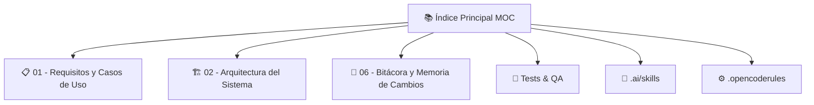

# 📚 ÍNDICE MAESTRO (MOC) - MICROAPPS WORKSPACE

> **Mapa de Contenido Operativo** — Navegación central para la bóveda de conocimiento del ecosistema MicroApps.
> Compatible con Obsidian (Dataview, Canvas, Graph View).

---

## 🗂️ ESTRUCTURA DE LA BÓVEDA

---

## 📋 01 - REQUISITOS Y CASOS DE USO
*Especificaciones funcionales, user stories, criterios de aceptación, flujos de usuario.*

| Archivo | Aplicación | Estado | Última Actualización |
|---------|------------|--------|---------------------|
| [[CajaViva - Especificacion.md]] | **CajaViva** | ✅ Aprobado | 2026-10-08 |

> **Plantilla estándar:** `[NombreApp] - Especificacion.md`
> - Contexto de negocio / Problem Statement
* - Actores y User Personas
* - User Stories (formato INVEST)
* - Criterios de Aceptación (Gherkin)
* - Flujos críticos (Mermaid)
* - Reglas de negocio
* - Métricas de éxito (KPIs)

---

## 🏗️ 02 - ARQUITECTURA DEL SISTEMA
*Decisiones arquitectónicas (ADR), diagramas C4, contratos API, modelos de datos, patrones.*

| Archivo | Aplicación | Estado | Última Actualización |
|---------|------------|--------|---------------------|
| [[ADR-0001 - Arquitectura Offline-First y Stack de CajaViva.md]] | **CajaViva** | ✅ Aceptado | 2026-10-08 |
| [[Mapa de Arquitectura.canvas]] | **CajaViva** | ✅ Generado | 2026-10-08 |

> **Plantilla estándar:** `[NombreApp] - Decisiones Arquitectura (ADR).md`
* - ADR Log (número, título, estado, fecha, consecuencia)
* - Stack Selection Rationale
* - Patrón Arquitectónico (Clean, Hexagonal, Modular Monolith)
* - Diagrama C4 (Contexto, Contenedores, Componentes, Código)
* - Contratos API (OpenAPI/Swagger)
* - Esquema de Datos (ERD / Pydantic Models)
* - Decisiones de Infraestructura (DB, Cache, Queue, Auth, Deploy)
* - Non-Functional Requirements (Latencia, Throughput, Disponibilidad, Seguridad)

---

## 📜 06 - BITÁCORA Y MEMORIA DE CAMBIOS
*Changelog cronológico, decisiones de revisión, incidentes, aprendizajes.*

| Archivo | Descripción |
|---------|-------------|
| [[Historial.md]] | Bitácora maestra del workspace |

---

## 🧪 TESTS & QA
*Estrategias de testing, configuración, reportes de cobertura.*

| Archivo | Descripción |
|---------|-------------|
| `tests/README.md` | Guía de testing (unit, integration, e2e, contract, performance) |
| `tests/pytest.ini` / `jest.config.ts` | Configuración por stack |

---

## ✨ FEATURES IMPLEMENTADAS (CAJAVIVA)

| Tarea | Descripción | Estado | Fecha |
|-------|-------------|--------|-------|
| **T-001** | PWA Foundation + IndexedDB + UI Shell | ✅ **DONE** | 2026-10-09 |
| **T-006** | Sync Engine Backend FastAPI | ✅ **DONE** | 2026-10-11 |
| **T-007** | Guardián Crediticio IA + Seguridad Crediticia | ✅ **DONE** | 2026-10-11 |
| **INFRA** | Backend Híbrido SQLite/Neon + Docker + Deploy | ✅ **DONE** | 2026-10-11 |

---

## 🧠 HABILIDADES ESPECIALIZADAS (SKILLS)
*Disponibles bajo demanda vía `.ai/skills/index.json`*

| Skill | Dominio | Activación |
|-------|---------|------------|
| **UI/UX (NextLevelBuilder)** | Frontend, Design System, A11y | `@skill ui-ux` |
| **Copywriting (Corey Haines)** | Marketing, Conversion, Onboarding | `@skill copywriting` |
| **Meta-Prompts (NidhinJS)** | Prompt Engineering, LLM Ops | `@skill meta-prompts` |
| **Auditoría Legal (COPPA/GDPR)** | Privacy, Compliance, Data Protection | `@skill legal-audit` |
| **Checklist Lanzamiento (20 pts)** | SEO, Schema.org, CWV, Security | `@skill launch-checklist` |

---

## ⚙️ CONFIGURACIÓN GLOBAL
- **Reglas del Orquestador:** [[.opencoderules]]
- **Skills Index:** `.ai/skills/index.json`
- **Cache Semántico:** `.ai/cache/` (generado automáticamente)

---

## 🔗 ENLACES RÁPIDOS OBSIDIAN
- `[[01 - Requisitos y Casos de Uso]]` — Carpeta de specs
- `[[02 - Arquitectura del Sistema]]` — Carpeta de ADRs
- `[[06 - Bitacora y Memoria de Cambios/Historial.md]]` — Changelog
- `[[.opencoderules]]` — Reglas globales

---

## 📌 PRÓXIMOS PASOS SUGERIDOS
1. ✅ **Definir primera aplicación** → **CajaViva** (Completado)
2. ✅ **Registrar especificación** → `[[CajaViva - Especificacion.md]]`
3. ✅ **Registrar ADR** → `[[ADR-0001 - Arquitectura Offline-First y Stack de CajaViva.md]]`
4. **Inicializar repo Git** + CI/CD pipeline para CajaViva
5. **Lead Engineer (Tier 2)**: Desglose de 5-6 tareas atómicas desde Loop Spec Fase 3
6. **Ejecutar primer Loop TDD** → Dev Agents (Tier 3)

---

*Última sincronización: `2026-10-11` — Generado automáticamente por Chief Architect Orchestrator*