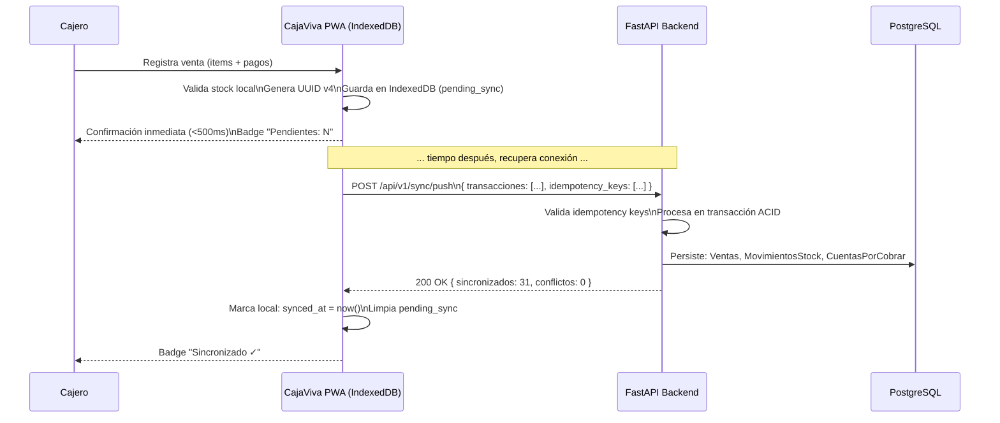
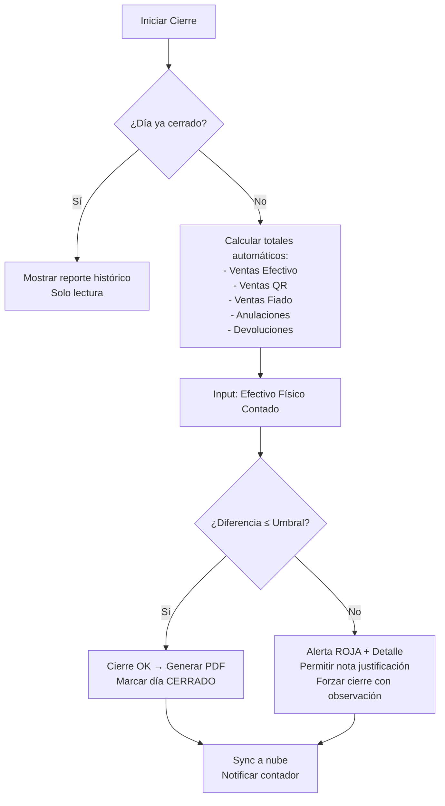

# 📋 ESPECIFICACIÓN FUNCIONAL — CAJAVIVA

> **Micro-SaaS Offline-First para comercio minorista de proximidad en Bolivia**
> Versión: 1.0 | Fecha: 2026-10-08 | Estado: Aprobado para Desarrollo

---

## 1. CONTEXTO DE NEGOCIO

### 1.1 Problem Statement
Los comerciantes minoristas en Santa Cruz de la Sierra y Bolivia (micromercados, boutiques, ferreterías, repuestos, farmacias de barrio) operan con **conectividad intermitente** y **herramientas manuales** (cuadernos, Excel, calculadora) que generan:
- **Pérdida de ventas** no registradas durante cortes de internet
- **Descuadres de caja** diarios por conciliación manual QR vs efectivo
- **Rupturas de stock** invisibles sin alertas automáticas
- **Cuentas por cobrar (fiados)** olvidadas sin seguimiento automatizado

### 1.2 Solución: CajaViva
**Micro-SaaS PWA Offline-First** que permite registrar ventas, controlar inventario, cerrar caja y gestionar fiados **sin conexión a internet**, sincronizando de forma **idempotente** cuando recupera conectividad.

---

## 2. ACTORES Y USER PERSONAS

| Actor | Descripción | Dispositivo Principal | Conectividad |
|-------|-------------|----------------------|--------------|
| **Dueño/Tenedor** | Propietario del negocio, toma decisiones | Smartphone Android (entry-mid) | Intermitente (WiFi + datos móviles) |
| **Cajero/Vendedor** | Registra ventas, atiende clientes | Smartphone Android / Tablet | Intermitente |
| **Contador/Asesor** | Revisa cierres, inventario, fiados (lectura) | Desktop / Laptop | Estable (oficina) |

---

## 3. USER STORIES (FORMATO INVEST)

### EPIC 1: VENTA RÁPIDA OFFLINE-FIRST

| ID | Historia | Prioridad | Criterios de Aceptación (Gherkin) |
|----|----------|-----------|-----------------------------------|
| **US-001** | Como **cajero**, quiero **registrar una venta en segundos** (efectivo/QR/fiado) **sin internet**, para no perder clientes cuando falla la conexión. | 🔴 Crítica | ```gherkin\nGiven que estoy sin conexión a internet\nWhen registro una venta: 3 items + pago mixto (50% efectivo, 50% QR)\nThen la venta se guarda localmente en < 500ms\nAnd el stock se descuenta inmediatamente en UI\nAnd aparece en "Pendientes de sincronizar" con badge contador\n``` |
| **US-002** | Como **cajero**, quiero **seleccionar productos por búsqueda/escaneo/categoría** para agilizar el checkout. | 🟠 Alta | ```gherkin\nGiven tengo 500+ productos cargados\nWhen busco "tornillo" o escaneo código de barras\nThen filtra resultados en < 200ms\nAnd muestro: nombre, precio, stock actual, categoría\n``` |
| **US-003** | Como **cajero**, quiero **registrar pago mixto** (efectivo + QR + fiado) en una sola venta. | 🟠 Alta | ```gherkin\nGiven una venta de 150 Bs\nWhen ingreso: 50 Bs efectivo + 70 Bs QR + 30 Bs fiado a "Juan Pérez"\nThen valida que suma = total venta\nAnd crea CuentaPorCobrar si monto fiado > 0\nAnd genera ticket con desglose de pagos\n``` |

### EPIC 2: CUADRE DE CAJA Y CONCILIACIÓN

| ID | Historia | Prioridad | Criterios de Aceptación |
|----|----------|-----------|------------------------|
| **US-004** | Como **dueño**, quiero **cerrar caja diario automatizado** que concilie efectivo físico vs ventas registradas + QR reportado. | 🔴 Crítica | ```gherkin\nGiven tengo 47 ventas del día (23 efectivo, 18 QR, 6 fiado)\nWhen ejecuto "Cierre de Caja" e ingreso efectivo físico contado: 2,450 Bs\nThen calcula: Total Ventas Efectivo = 2,430 Bs\nAnd Diferencia = +20 Bs (sobrante) → Alerta visual verde\nAnd genera reporte PDF/Excel con desglose por método de pago\nAnd marca día como "Cerrado" (inmutable)\n``` |
| **US-005** | Como **dueño**, quiero **ver alerta si hay descuadres** mayores a umbral configurable (ej. ±5 Bs). | 🟠 Alta | ```gherkin\nGiven umbral descuadre = 5 Bs\nWhen cierre muestra diferencia = -12 Bs\nThen alerta roja: "DESCUADRE: -12 Bs — Revisar ventas anuladas / cambio mal dado"\nAnd registra en auditoría para trazabilidad\n``` |

### EPIC 3: INVENTARIO CON ALERTAS DE STOCK MÍNIMO

| ID | Historia | Prioridad | Criterios de Aceptación |
|----|----------|-----------|------------------------|
| **US-006** | Como **dueño**, quiero **alertas automáticas** cuando stock ≤ mínimo configurado, para reponer antes de ruptura. | 🔴 Crítica | ```gherkin\nGiven producto "Tornillo 1/2\"" stock actual = 5, stock mínimo = 10\nWhen se vende 1 unidad (stock → 4)\nThen aparece badge rojo en producto: "STOCK CRÍTICO (4/10)"\nAnd notificación push local: "Reponer: Tornillo 1/2\" — Stock 4 (mín 10)"\n``` |
| **US-007** | Como **dueño**, quiero **ajustar inventario** (entrada/salida/merma) con trazabilidad. | 🟡 Media | ```gherkin\nWhen registro "Entrada: 50 unidades Tornillo 1/2\" — Proveedor: Ferretería Central"\nThen stock actualiza 4 → 54\nAnd crea MovimientoStock tipo ENTRADA con proveedor, fecha, usuario\n``` |

### EPIC 4: LIBRETA DE FIADOS + RECORDATORIOS WHATSAPP

| ID | Historia | Prioridad | Criterios de Aceptación |
|----|----------|-----------|------------------------|
| **US-008** | Como **dueño**, quiero **registrar fiado** al cliente con nombre, teléfono, monto, fecha límite. | 🔴 Crítica | ```gherkin\nWhen creo fiado: Cliente "María López", Tel "+591 7xxxxxxx", 120 Bs, vencimiento 7 días\nThen crea CuentaPorCobrar con estado PENDIENTE\nAnd aparece en lista "Fiados Activos" ordenada por vencimiento\n``` |
| **US-009** | Como **dueño**, quiero **enviar recordatorio por WhatsApp** con enlace de pago directo (QR/transferencia). | 🔴 Crítica | ```gherkin\nGiven fiado de María López vence mañana (120 Bs)\nWhen toco "Recordar por WhatsApp"\nThen abre WhatsApp con mensaje prellenado:\n\"Hola María, recordatorio amable: tu cuenta de 120 Bs en [Negocio] vence mañana. Paga aquí: [QR/link]. ¡Gracias!\"\nAnd registra envío en historial con timestamp\n``` |
| **US-010** | Como **dueño**, quiero **marcar fiado como pagado** (parcial/total) y ver saldo pendiente. | 🟠 Alta | ```gherkin\nGiven fiado 120 Bs pendiente\nWhen registro pago parcial: 50 Bs efectivo\nThen actualiza saldo: 70 Bs pendiente\nAnd crea MovimientoCobro vinculado a CuentaPorCobrar\n``` |

### EPIC 5: SINCRONIZACIÓN IDEMPOTENTE (OFFLINE-FIRST)

| ID | Historia | Prioridad | Criterios de Aceptación |
|----|----------|-----------|------------------------|
| **US-011** | Como **sistema**, quiero **sincronizar transacciones offline** al recuperar conexión sin duplicados ni pérdidas. | 🔴 Crítica | ```gherkin\nGiven 23 ventas + 5 ajustes stock + 3 fiados guardados offline\nWhen recupera conectividad (WiFi/datos)\nThen envía lote POST /api/v1/sync/push con UUIDs únicos\nAnd servidor responde: { sincronizados: 31, conflictos: 0 }\nAnd marca local como "Sincronizado ✓"\nAnd reintenta automáticos con backoff exponencial si falla\n``` |
| **US-012** | Como **sistema**, quiero **resolver conflictos** (ej. mismo producto editado offline en 2 dispositivos) con estrategia último-escritor-gana + log. | 🟠 Alta | ```gherkin\nGiven stock "Tornillo" editado en Device A (→ 50) y Device B (→ 45) offline\nWhen ambos sincronizan\nThen gana el de timestamp más reciente\nAnd log conflicto en auditoría para revisión manual\n``` |

---

## 4. REGLAS DE NEGOCIO CRÍTICAS

| Regla | Descripción | Validación |
|-------|-------------|------------|
| **RB-001** | **Moneda única:** Bolivianos (Bs). Sin decimales (entero). | `amount: conint(ge=0)` |
| **RB-002** | **Idempotencia:** Toda mutación requiere `client_transaction_id` (UUID v4). | Header `Idempotency-Key` obligatorio en POST/PUT |
| **RB-003** | **Cierre inmutable:** Una vez cerrado el día, no se modifican ventas de ese día. | `ArqueoCaja.estado = CERRADO` → bloquea edición |
| **RB-004** | **Stock nunca negativo:** Venta valida stock disponible antes de confirmar. | `stock_actual >= cantidad_vendida` |
| **RB-005** | **Fiado requiere teléfono válido Bolivia:** Formato `+591 [67]xxxxxxx`. | Regex `^\+591[67]\d{7}$` |
| **RB-006** | **QR pago:** Generado por proveedor externo (Banco/QR simple), CajaViva solo referencia `qr_reference_id`. | String opcional, max 100 chars |

---

## 5. MÉTRICAS DE ÉXITO (KPIs)

| KPI | Target | Medición |
|-----|--------|----------|
| **Tiempo registro venta** | < 15 segundos (mediana) | Event `venta_registrada_duration_ms` |
| **Tasa sincronización exitosa** | > 99.5% primer intento | `sync_success_rate` diario |
| **Descuadre caja mensual** | < 0.1% del volumen ventas | `(Σ|diferencias| / Σ ventas) * 100` |
| **Rupturas stock/mes** | 0 (alertas 100% oportunas) | Alertas disparadas vs rupturas reales |
| **Cobranza fiados a 30 días** | > 85% | `fiados_cobrados_30d / fiados_vencidos_30d` |
| **Usuarios activos semanales (WAU)** | > 80% comercios suscritos | Event `app_open` unique users/semana |

---

## 6. FLUJOS CRÍTICOS (MERMAID)

### Flujo Venta Offline → Sync


### Flujo Cierre de Caja


---

## 7. REQUISITOS NO FUNCIONALES

| Categoría | Requisito | Especificación |
|-----------|-----------|----------------|
| **Offline-First** | Funcionalidad completa sin red | 100% features CRUD locales |
| **Sincronización** | Idempotencia + reintentos | Exponential backoff (1s, 2s, 4s, 8s, max 5min) |
| **Performance** | Inicio en frío < 3s | PWA + Service Worker + Cache First |
| **Storage Local** | Límite IndexedDB | ~50MB (≈ 50k ventas + 10k productos) |
| **Seguridad** | Datos en reposo cifrados | Web Crypto API (AES-GCM) para IndexedDB sensible |
| **Accesibilidad** | WCAG 2.1 AA | Contraste, focus, ARIA, screen reader |
| **Idioma** | Español (Bolivia) + regionalismos | "Fiado" no "Cuenta por cobrar" en UI |
| **Moneda** | Bolivianos (Bs) entero | Sin decimales, separador miles: `.` |

---

## 8. ALCANCE FASE 1 (MVP - 6 SEMANAS)

| Incluido | Fuera de Alcance (Fase 2+) |
|----------|---------------------------|
| ✅ Venta rápida offline (efectivo/QR/fiado) | ❌ Multi-sucursal / multi-usuario concurrente |
| ✅ Cierre caja + conciliación QR | ❌ Facturación electrónica SIN (Bolivia) |
| ✅ Inventario + alertas stock mínimo | ❌ Proveedores / Órdenes de compra |
| ✅ Fiados + WhatsApp reminders | ❌ Reportes avanzados / BI / Dashboards |
| ✅ Sync idempotente + conflictos | ❌ API pública para integraciones |
| ✅ PWA instalable + Service Worker | ❌ App nativa iOS/Android |

---

**Firmado:** Chief Architect | **Fecha:** 2026-10-08 | **Versión:** 1.0