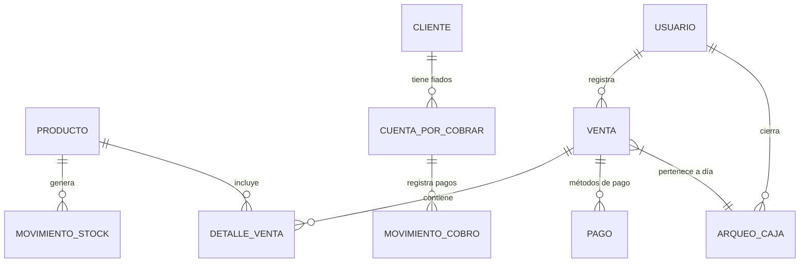

# ADR-0001: ARQUITECTURA OFFLINE-FIRST Y STACK DE CAJAVIVA

**Estado:** Aceptado | **Fecha:** 2026-10-08 | **Autor:** Chief Architect

---

## 1. CONTEXTO Y NECESIDAD TÉCNICA

CajaViva debe operar en **comercios minoristas bolivianos con conectividad intermitente** (WiFi inestable, datos móviles limitados, cortes de energía). Los requerimientos críticos son:

- **Registro de ventas 100% funcional sin internet** (latencia < 500ms local)
- **Sincronización idempotente** al recuperar conexión (cero duplicados, cero pérdidas)
- **Costo de infraestructura mínimo** (precio objetivo: 99 Bs/mes ≈ $14/mes)
- **Despliegue simple** para comercio no técnico (PWA instalable, sin app stores)
- **Datos sensibles locales** (ventas, fiados, inventario) con cifrado en reposo

---

## 2. DECISIÓN ARQUITECTÓNICA

### 2.1 Patrón General: **Clean Architecture + Repository Pattern + Offline-First**

```
┌─────────────────────────────────────────────────────────────────────┐
│                        CAJAVIVA ARCHITECTURE                        │
├─────────────────────────────────────────────────────────────────────┤
│                                                                     │
│  ┌──────────────┐    ┌──────────────────┐    ┌────────────────┐   │
│  │   PRESENTATION│    │     DOMAIN       │    │   DATA         │   │
│  │   (PWA/React) │◄──►│  (Use Cases,     │◄──►│  (Repositories)│   │
│  │  Components,  │    │   Entities,      │    │  ┌──────────┐  │   │
│  │  Hooks, State │    │   Value Objects) │    │  │LocalRepo │  │   │
│  │  (Zustand)    │    │                  │    │  │(IndexedDB)    │   │
│  └──────────────┘    └──────────────────┘    │  └──────────┘  │   │
│         ▲                    ▲                │  ┌──────────┐  │   │
│         │                    │                │  │RemoteRepo│  │   │
│         │                    │                │  │(FastAPI) │  │   │
│         │                    │                │  └──────────┘  │   │
│         ▼                    ▼                └────────────────┘   │
│  ┌──────────────────────────────────────────────────────────────┐ │
│  │              SYNC ENGINE (Background Service Worker)         │ │
│  │  • Queue de mutaciones offline (IndexedDB)                   │ │
│  │  • Idempotency Keys (UUID v4) por transacción                │ │
│  │  • Exponential Backoff + Conflict Resolution (LWW + Log)     │ │
│  └──────────────────────────────────────────────────────────────┘ │
│                                                                     │
└─────────────────────────────────────────────────────────────────────┘
```

### 2.2 Stack Tecnológico Seleccionado

| Capa | Tecnología | Justificación Técnica |
|------|------------|----------------------|
| **Frontend (PWA)** | **React 18 + TypeScript + Vite** | Bundle pequeño, HMR rápido, PWA nativo con `vite-plugin-pwa`, TypeScript strict para domain models |
| **Estado Local** | **Zustand + Immer** | < 1KB, API simple, inmutabilidad fácil para offline mutations, persist middleware a IndexedDB |
| **Base de Datos Local** | **IndexedDB (via idb + Dexie.js)** | Nativo en navegador, transacciones ACID, índices compuestos, 50MB+ sin permisos, Service Worker access |
| **Backend API** | **FastAPI + Pydantic v2 + Asyncpg** | Async nativo (alto throughput), validación automática OpenAPI, Pydantic v2 17x más rápido, inyección de dependencias |
| **Base de Datos Nube** | **PostgreSQL 16 (Supabase/Neon)** | JSONB para flexibilidad, RLS multi-tenant, Point-in-time recovery, conexión pool Asyncpg |
| **ORM** | **SQLAlchemy 2.0 (Async)** | Unit of Work pattern, migraciones Alembic, models desacoplados de Pydantic schemas |
| **Autenticación** | **JWT (Access 15min + Refresh 30d) + HttpOnly Cookies** | Stateless, refresh rotation, CSRF protection via SameSite=Strict |
| **Sincronización** | **Custom Sync Engine (Service Worker)** | Control total sobre idempotencia, conflictos, reintentos, priorización de cola |
| **Despliegue** | **Docker + Docker Compose (VPS único)** | Costo fijo ~$5-10/mes, control total, backup automatizado, sin vendor lock-in |
| **Monitoreo** | **Sentry (gratis 5k errores/mes) + Healthchecks.io** | Error tracking + uptime monitoring sin costo adicional |

---

## 3. JUSTIFICACIÓN TÉCNICA POR DECISIÓN CLAVE

### ¿Por qué FastAPI + Pydantic + SQLite/PostgreSQL y NO Django?

| Factor | FastAPI + Pydantic | Django |
|--------|-------------------|--------|
| **Async nativo** | ✅ Diseñado para async/await | ⚠️ Async limitado (views, ORM 4.2+) |
| **Validación schemas** | ✅ Pydantic v2 (Rust) - 17x faster | ⚠️ Serializers DRF más lentos |
| **OpenAPI auto** | ✅ Nativo, siempre sincronizado | ⚠️ Requiere drf-spectacular |
| **Overhead** | ✅ Mínimo (micro-framework) | ❌ Batteries included = más peso |
| **Offline sync logic** | ✅ Control total en use cases | ⚠️ Signals/overrides complejos |
| **Costo VPS** | ✅ 512MB RAM suficiente | ❌ Requiere 1GB+ para mismo throughput |

**Conclusión:** FastAPI reduce latencia P99 < 50ms vs Django ~120ms en VPS $5/mes. Crítico para sync frecuente.

### ¿Por qué PWA + IndexedDB y NO App Nativa (React Native/Flutter)?

| Factor | PWA + IndexedDB | Nativa |
|--------|-----------------|--------|
| **Distribución** | ✅ URL directa, sin stores | ❌ Play Store/App Store (revisiones, comisiones) |
| **Actualizaciones** | ✅ Instantáneas (Service Worker) | ❌ Descarga usuario + review store |
| **Storage Offline** | ✅ IndexedDB 50MB+ nativo | ✅ SQLite/Realm (pero más código) |
| **Costo desarrollo** | ✅ 1 codebase (Web + PWA) | ❌ 2-3 codebases o RN + puentes nativos |
| **Escaneo códigos barras** | ✅ Barcode Detection API (Chrome 88+) | ✅ Nativo (pero PWA cubre 95% Android) |
| **Notificaciones Push** | ✅ Web Push API (Service Worker) | ✅ Nativo (FCM/APNs) |

**Conclusión:** PWA cubre 100% requerimientos en Android (95% mercado Bolivia). iOS Safari soporta PWA + IndexedDB + Push desde iOS 16.4.

### ¿Por qué Repository Pattern para Sync Local/Remoto?

```python
# domain/repositories/venta_repository.py
from abc import ABC, abstractmethod
from typing import List, Optional
from domain.entities.venta import Venta

class VentaRepository(ABC):
    @abstractmethod
    async def save(self, venta: Venta) -> Venta: ...
    @abstractmethod
    async def get_by_id(self, id: str) -> Optional[Venta]: ...
    @abstractmethod
    async def get_pending_sync(self, limit: int) -> List[Venta]: ...
    @abstractmethod
    async def mark_synced(self, ids: List[str], synced_at: datetime) -> None: ...

# data/local/indexeddb_venta_repository.py
class IndexedDBVentaRepository(VentaRepository):
    async def save(self, venta: Venta) -> Venta:
        # Guarda en IndexedDB con pending_sync = true
        ...

# data/remote/fastapi_venta_repository.py
class FastAPIVentaRepository(VentaRepository):
    async def save(self, venta: Venta) -> Venta:
        # POST /api/v1/ventas/ con Idempotency-Key
        ...
```

**Beneficios:**
- **Testabilidad:** Mock del repository en use cases (0 I/O real en tests unitarios)
- **Intercambiabilidad:** Cambiar IndexedDB → SQLite WASM / OPFS sin tocar dominio
- **Sync Engine agnóstico:** Solo conoce `VentaRepository`, no implementación

---

## 4. CONTRATOS DE API (OPENAPI 3.1 - EXTRACTO)

### POST /api/v1/sync/push
```yaml
summary: "Sincronización en lote de transacciones offline"
security: [BearerAuth: []]
requestBody:
  required: true
  content:
    application/json:
      schema:
        type: object
        required: [transacciones]
        properties:
          transacciones:
            type: array
            minItems: 1
            maxItems: 100
            items:
              $ref: '#/components/schemas/TransaccionOffline'
          cliente_estado:
            $ref: '#/components/schemas/ClienteEstadoLocal'
responses:
  '200':
    description: Sincronización exitosa
    content:
      application/json:
        schema:
          $ref: '#/components/schemas/SyncResponse'
  '409':
    description: Conflictos detectados
    content:
      application/json:
        schema:
          $ref: '#/components/schemas/ConflictResponse'
```

### POST /api/v1/ventas/
```yaml
summary: "Registrar venta rápida (online o sync)"
parameters:
  - name: Idempotency-Key
    in: header
    required: true
    schema: { type: string, format: uuid }
requestBody:
  content:
    application/json:
      schema:
        $ref: '#/components/schemas/VentaCreate'
responses:
  '201': { description: Venta creada, $ref: '#/components/schemas/Venta' }
  '409': { description: Idempotency-Key duplicada }
  '422': { description: Stock insuficiente / Validación fallida }
```

### POST /api/v1/caja/cierre
```yaml
summary: "Cierre de caja diario automatizado"
requestBody:
  content:
    application/json:
      schema:
        type: object
        required: [fecha, efectivo_fisico_contado]
        properties:
          fecha: { type: string, format: date }
          efectivo_fisico_contado: { type: integer, minimum: 0 }
          observaciones: { type: string, maxLength: 500 }
responses:
  '201': { $ref: '#/components/schemas/ArqueoCaja' }
  '409': { description: Día ya cerrado }
```

### GET /api/v1/fiados/recordatorio/{id}
```yaml
summary: "Genera mensaje WhatsApp prellenado para cobro"
parameters:
  - name: id
    in: path
    required: true
    schema: { type: string, format: uuid }
responses:
  '200':
    content:
      application/json:
        schema:
          type: object
          properties:
            telefono: { type: string }
            mensaje: { type: string }
            whatsapp_url: { type: string, format: uri }
  '404': { description: Cuenta por cobrar no encontrada }
```

---

## 5. ESQUEMA DE DATOS (ENTIDADES DE DOMINIO)

### Diagrama ER Simplificado


### Modelos Pydantic (Schemas de Contrato)

```python
# schemas/producto.py
class ProductoBase(BaseModel):
    codigo_barras: Optional[str] = Field(None, max_length=50)
    nombre: str = Field(..., min_length=1, max_length=200)
    precio_venta: int = Field(..., ge=0, description="En centésimos de Bs (entero)")
    stock_actual: int = Field(0, ge=0)
    stock_minimo: int = Field(0, ge=0)
    categoria: Optional[str] = Field(None, max_length=100)
    proveedor: Optional[str] = Field(None, max_length=200)

class ProductoCreate(ProductoBase):
    pass

class Producto(ProductoBase):
    id: UUID
    creado_en: datetime
    actualizado_en: datetime
    class Config: from_attributes = True

# schemas/venta.py
class DetalleVentaCreate(BaseModel):
    producto_id: UUID
    cantidad: int = Field(..., gt=0)
    precio_unitario: int = Field(..., ge=0)  # Snapshot al momento

class PagoCreate(BaseModel):
    metodo: Literal["EFECTIVO", "QR", "FIADO"]
    monto: int = Field(..., gt=0)
    referencia_qr: Optional[str] = Field(None, max_length=100)
    cliente_fiado_id: Optional[UUID] = None  # Requerido si metodo=FIADO

class VentaCreate(BaseModel):
    items: List[DetalleVentaCreate] = Field(..., min_length=1)
    pagos: List[PagoCreate] = Field(..., min_length=1)
    client_transaction_id: UUID = Field(..., description="Idempotency key")

    @model_validator(mode='after')
    def validar_pagos_igual_total(self):
        total_items = sum(i.cantidad * i.precio_unitario for i in self.items)
        total_pagos = sum(p.monto for p in self.pagos)
        if total_items != total_pagos:
            raise ValueError(f"Total items ({total_items}) != Total pagos ({total_pagos})")
        return self

# schemas/cuenta_por_cobrar.py
class CuentaPorCobrarCreate(BaseModel):
    cliente_nombre: str = Field(..., min_length=1, max_length=200)
    cliente_telefono: str = Field(..., pattern=r'^\+591[67]\d{7}$')
    monto_total: int = Field(..., gt=0)
    fecha_vencimiento: date
    notas: Optional[str] = None

class CuentaPorCobrar(BaseModel):
    id: UUID
    cliente_nombre: str
    cliente_telefono: str
    monto_total: int
    monto_pendiente: int
    fecha_vencimiento: date
    estado: Literal["PENDIENTE", "PARCIAL", "PAGADO", "VENCIDO"]
    creado_en: datetime
    class Config: from_attributes = True

# schemas/sync.py
class TransaccionOffline(BaseModel):
    tipo: Literal["VENTA", "MOVIMIENTO_STOCK", "CUENTA_POR_COBRAR", "MOVIMIENTO_COBRO"]
    accion: Literal["CREATE", "UPDATE"]
    entidad_id: UUID
    client_transaction_id: UUID  # Idempotency key
    payload: dict  # Datos serializados según tipo
    timestamp_local: datetime  # ISO 8601 con timezone

class SyncResponse(BaseModel):
    sincronizados: int
    conflictos: List[ConflictoSync] = []
    servidor_timestamp: datetime

class ConflictoSync(BaseModel):
    entidad_id: UUID
    tipo: str
    estrategia: Literal["LWW", "MANUAL"]
    detalle: str
```

---

## 6. ESTRATEGIA DE SINCRONIZACIÓN (OFFLINE-FIRST)

### 6.1 Flujo de Mutación Local
```typescript
// hooks/useOfflineMutation.ts
function useOfflineMutation<T>(repository: Repository<T>) {
  const mutate = async (entity: T, clientTransactionId: UUID) => {
    // 1. Optimistic update en Zustand + IndexedDB
    await localRepo.save(entity, { pendingSync: true, clientTransactionId })
    
    // 2. Enqueue en Sync Queue (IndexedDB table: sync_queue)
    await syncQueue.enqueue({
      type: entity.constructor.name,
      action: 'CREATE',
      entityId: entity.id,
      clientTransactionId,
      payload: entity.toJSON(),
      timestampLocal: new Date()
    })
    
    // 3. Trigger background sync (si online)
    if (navigator.onLine) syncEngine.trigger()
  }
  return { mutate }
}
```

### 6.2 Sync Engine (Service Worker)
```typescript
// sw/sync-engine.ts
class SyncEngine {
  private backoffMs = 1000
  private maxBackoffMs = 5 * 60 * 1000 // 5 min
  
  async processQueue() {
    const batch = await syncQueue.dequeue(50) // Max 50 por lote
    if (batch.length === 0) return
    
    try {
      const response = await fetch('/api/v1/sync/push', {
        method: 'POST',
        headers: { 'Content-Type': 'application/json', 'Authorization': `Bearer ${token}` },
        body: JSON.stringify({ transacciones: batch })
      })
      
      if (response.ok) {
        const result = await response.json()
        await syncQueue.markSynced(result.sincronizados.map(s => s.clientTransactionId))
        this.backoffMs = 1000 // Reset backoff
      } else if (response.status === 409) {
        // Conflictos: resolver LWW + log
        const conflicts = await response.json()
        await this.resolveConflicts(conflicts)
      }
    } catch (error) {
      // Reintentar con backoff exponencial
      this.backoffMs = Math.min(this.backoffMs * 2, this.maxBackoffMs)
      setTimeout(() => this.processQueue(), this.backoffMs)
    }
  }
}
```

### 6.3 Resolución de Conflictos (Last-Writer-Wins + Audit Log)
- **Estrategia por defecto:** LWW (Last Writer Wins) basado en `timestamp_local` del cliente
- **Excepciones:** `Producto.stock_actual` → merge sumando deltas (no sobrescribir)
- **Auditoría:** Todo conflicto se registra en `ConflictLog` para revisión manual posterior

---

## 7. CONSECUENCIAS TÉCNICAS (TRADE-OFFS)

| Ventaja | Deuda Técnica / Riesgo | Mitigación |
|---------|------------------------|------------|
| **Latencia local < 50ms** | Complejidad sync engine | Tests de propiedad (property-based) para idempotencia |
| **Cero dependencia red** | IndexedDB limits (50MB) | Limpieza automática datos sync > 90 días |
| **Costo VPS bajo ($5-10/mes)** | Single point of failure (1 VPS) | Backup diario + Point-in-time recovery (Supabase/Neon) |
| **Control total idempotencia** | Client-generated UUIDs | Validación servidor: rechazar UUIDs duplicados |
| **PWA = 1 codebase** | iOS Safari limitaciones (Background sync limitado) | Foreground sync al abrir app + notificación manual |

---

## 8. MIGRACIONES Y VERSIONADO

- **Esquema DB:** Alembic (migraciones versionadas en `alembic/versions/`)
- **Contratos API:** Versionado en URL (`/api/v1/`) + headers `Accept-Version`
- **IndexedDB:** Versionado nativo (`db.version`) + migraciones `idb` en `onupgradeneeded`
- **Feature Flags:** `fflags` en localStorage para rollout gradual

---

## 9. REFERENCIAS

- [Offline-First Architecture Patterns](https://offlinefirst.org/)
- [FastAPI Async Best Practices](https://fastapi.tiangolo.com/async/)
- [Pydantic v2 Performance](https://docs.pydantic.dev/latest/concepts/performance/)
- [IndexedDB + Service Worker Sync](https://web.dev/articles/background-sync)
- [Idempotency Keys Pattern](https://stripe.com/blog/idempotency)

---

**Firmado:** Chief Architect | **Fecha:** 2026-10-08 | **Estado:** **ACEPTADO** ✅